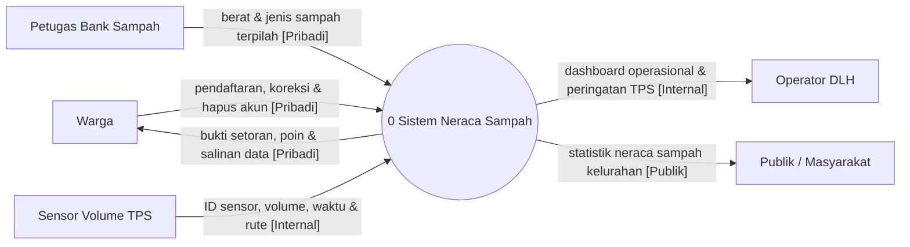
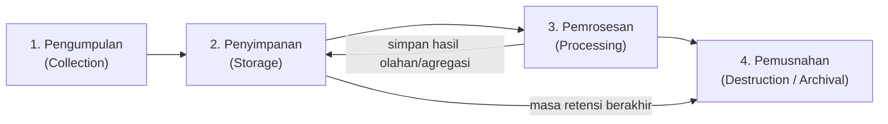

# MODUL 3.1 — ALUR DATA DAN TATA KELOLA DATA

**Mata Kuliah:** Teknologi Smart City (ET234504)  
**Departemen:** Teknologi Informasi, ITS  
**Beban Praktikum:** 1 SKS  
**Semester:** 5  
**Tahap:** Perancangan *Proof of Concept* (PoC) — Bagian 1

---

## 1. Tujuan Pembelajaran

Setelah mempelajari modul ini, mahasiswa diharapkan mampu:

- Menyusun *Data Flow Diagram* (DFD) menggunakan notasi Yourdon–DeMarco yang konsisten dan memberi label klasifikasi data pada setiap aliran (T3.1).
- Memetakan siklus hidup data empat tahap mulai dari pengumpulan sampai pemusnahan untuk seluruh penyimpanan data (T3.1).
- Menentukan kontrol keamanan teknis pada setiap lapisan arsitektur berdasarkan prinsip CIA (T3.2).
- Menerapkan ketentuan Undang-Undang Pelindungan Data Pribadi (UU PDP) dan prinsip etika pemanfaatan data warga ke dalam fitur serta prosedur sistem (T3.2).
- Mengidentifikasi risiko keamanan, privasi, etika, dan operasional beserta kontrol mitigasi dan risiko residualnya (T3.2).
- Menurunkan proses dan aliran data pada DFD menjadi daftar layar utama serta skenario alur pengguna (*user flow*) sebagai jembatan menuju perancangan *mockup* PoC.

---

## 2. Pendahuluan

Modul 1 menghasilkan isu prioritas yang tervalidasi beserta pemetaan *stakeholder* dan pilar Kota Cerdas. Modul 2 menerjemahkan isu tersebut menjadi kebutuhan sistem, memilih teknologi menggunakan *Analytic Hierarchy Process* (AHP) dan *Weighted Decision Matrix* (WDM), serta menyusun arsitektur sistem empat lapis.

Arsitektur yang telah disusun pada Modul 2 baru menjelaskan **komponen teknologi apa** yang digunakan. Sebelum solusi diwujudkan menjadi *Proof of Concept* (PoC), perancang sistem harus menjawab pertanyaan mendasar: **bagaimana data dikelola secara aman, sah, dan etis?**

Modul 3.1 membahas pengelolaan data tersebut melalui dua tugas praktikum dengan total **20 poin** (estimasi waktu pengerjaan kelompok 3 orang: ±90 menit):

| Kode Tugas & Poin | Fokus Materi & Luaran Wajib | *Sheet* Kerja Praktikum | Estimasi Waktu |
|---|---|---|---|
| **T3.1** (10 poin) | Daftar elemen DFD, Diagram Konteks, DFD Level 0 berlabel klasifikasi data, dan Tabel Siklus Hidup Data 4 tahap untuk seluruh penyimpanan data | `3.1 Alur & Siklus Data` | ±45 menit |
| **T3.2** (10 poin) | Tabel Kontrol Keamanan Teknis per Lapisan (CIA), Tabel Kepatuhan UU PDP & Etika Data Warga, serta Tabel Identifikasi Risiko, Mitigasi & Risiko Residual (minimal 6 baris) | `3.2 Keamanan & Risiko Data` | ±45 menit |

> **Prinsip keterlacakan (*traceability*):** seluruh proses, penyimpanan data, dan aliran data pada Modul 3.1 wajib diturunkan dari komponen arsitektur empat lapis pada Modul 2 (`T2.4`). Selanjutnya, proses dan aliran data pada Modul 3.1 ini akan menjadi dasar penentuan layar utama *mockup* aplikasi serta perencanaan operasional pada Modul 3.2.

### Kasus Ilustrasi

Seluruh contoh dalam Modul 3.1 dan Modul 3.2 melanjutkan kasus persampahan Kota Surabaya dari Modul 1.3 dan 1.4. Solusi yang digunakan sebagai ilustrasi adalah **Sistem Neraca Sampah Terpadu Kota Surabaya** yang terdiri atas:

1. **Perangkat lapangan:** node sensor ultrasonik pemantau persentase keterisian volume pada Tempat Penampungan Sementara (TPS) yang terintegrasi dengan pencatatan kode rute armada angkut, serta timbangan digital pada Bank Sampah tingkat RW.
2. **Jaringan komunikasi:** konektivitas seluler untuk pengiriman telemetri sensor dan akses aplikasi.
3. **Platform data:** layanan *backend* dan API, basis data relasional untuk akun serta transaksi setoran, dan basis data deret waktu (*time-series*) untuk telemetri volume TPS.
4. **Aplikasi layanan:** aplikasi pencatatan setoran dan pengelolaan akun bagi warga serta pengurus Bank Sampah RW, *dashboard* operasional bagi Dinas Lingkungan Hidup (DLH) Kota Surabaya, dan halaman statistik neraca sampah terbuka bagi masyarakat umum.

---

## 3. Data Flow Diagram (DFD)

### 3.1 Konsep DFD dan Perbedaannya dari Diagram Arsitektur

*Data Flow Diagram* (DFD) adalah pemodelan grafis yang memetakan **pergerakan dan transformasi data** di dalam sistem informasi: dari mana data berasal, proses logis apa yang mengolahnya, di mana data disimpan, dan ke mana hasil olahan dikirimkan (DeMarco, 1979).

DFD berbeda secara mendasar dari diagram arsitektur sistem pada Modul 2:

| Aspek Perbandingan | Diagram Arsitektur Sistem (Modul 2) | *Data Flow Diagram* (Modul 3.1) |
|---|---|---|
| Fokus pemodelan | Komponen perangkat keras, jaringan, *platform*, dan aplikasi | Aliran data, proses pengolahan, dan penyimpanan data logis |
| Contoh elemen | *Sensor ultrasonik, LoRaWAN/4G, broker MQTT, PostgreSQL* | *Data volume TPS, Proses 3.0 Hitung Neraca Sampah, D1 Data Warga* |
| Pertanyaan yang dijawab | Sistem dibangun menggunakan teknologi apa? | Data apa yang masuk, diolah, disimpan, dan dikirim kepada siapa? |

DFD memodelkan aliran data secara logis, sehingga tidak digunakan untuk menggambarkan urutan waktu eksekusi, percabangan logika (*if-else*), atau perulangan (*loop*).

### 3.2 Notasi Yourdon–DeMarco dan Aturan Metodologis

Modul ini menggunakan notasi **Yourdon–DeMarco** (DeMarco, 1979). Gunakan satu notasi secara konsisten pada seluruh diagram dan jangan mencampurnya dengan notasi lain seperti Gane–Sarson.

| Elemen DFD | Simbol Yourdon–DeMarco | Fungsi | Aturan Penamaan |
|---|---|---|---|
| **Entitas eksternal** (*External Entity*) | Persegi / persegi panjang | Pihak, organisasi, perangkat sumber, atau sistem di luar batas sistem yang mengirim atau menerima data | Kata benda: *Warga*, *Petugas Bank Sampah*, *Operator DLH*, *Publik* |
| **Proses** (*Process*) | Lingkaran | Aktivitas yang mengubah, memvalidasi, atau meneruskan data masukan menjadi keluaran | Nomor + kata kerja aktif + objek: *1.0 Kelola Akun, Hak Subjek Data, & Catat Setoran* |
| **Penyimpanan data** (*Data Store*) | Dua garis sejajar horizontal | Tempat penyimpanan data secara logis di dalam sistem | Kode `D1`, `D2`, dst. + kata benda: *D1 Data Warga*, *D2 Transaksi Setoran* |
| **Aliran data** (*Data Flow*) | Anak panah berlabel | Perpindahan paket data antar-elemen | Kata benda nama data + label klasifikasi, **bukan** kata kerja aksi: *berat & jenis sampah [Pribadi]* (bukan *kirim data*) |

Aturan ketepatan metodologis DFD (DeMarco, 1979):

1. **Kelengkapan aliran proses:** setiap proses wajib memiliki minimal satu aliran masuk dan satu aliran keluar.
2. **Larangan aliran pintas:** data tidak boleh mengalir langsung dari entitas eksternal ke penyimpanan data, dari penyimpanan data ke entitas eksternal, atau antarpenyimpanan data tanpa melewati suatu proses.
3. **Keseimbangan masukan dan keluaran pada penyimpanan data:** setiap *data store* harus memiliki aliran masuk (proses yang menulis/memperbarui data) dan aliran keluar (proses yang membaca/menggunakan data). Penyimpanan data yang hanya ditulis tanpa pernah dibaca (*write-only / black hole*) menunjukkan adanya proses yang belum dimodelkan.
4. **Keterlacakan fitur privasi:** mekanisme pemenuhan hak subjek data (seperti pembaruan profil, permintaan salinan data, atau penghapusan akun) harus tampak sebagai aliran data nyata pada DFD, bukan hanya ditulis dalam narasi.

> **Catatan penggambaran simbol penyimpanan data:** pada perangkat lunak diagram seperti *draw.io* (diagrams.net) atau *Figma*, gunakan simbol **dua garis sejajar** (*Data Store* pada pustaka bentuk DFD). Apabila menggunakan *Mermaid* untuk membuat sketsa awal di dokumen Markdown, Mermaid membatasi bentuk penyimpanan pada simbol silinder `[(...)]`. Oleh karena itu, luaran final kelompok wajib digambar menggunakan *draw.io* atau alat visual serupa agar simbol dua garis sejajar sesuai standar Yourdon–DeMarco.

### 3.3 Level DFD yang Digunakan

Praktikum ini membatasi pemodelan pada dua level agar proporsional dengan beban 1 SKS:

| Level | Cakupan Isi | Batas Kompleksitas Praktikum |
|---|---|---|
| **Diagram Konteks** | Satu lingkaran proses tunggal (`0`) yang mewakili sistem secara utuh beserta seluruh entitas eksternal yang berinteraksi dengannya | 1 proses utama (`0`) dan seluruh entitas eksternal yang konsisten dengan Level 0 |
| **DFD Level 0** | Penjabaran proses `0` menjadi proses-proses utama (`1.0`, `2.0`, dst.), penyimpanan data (`D1`, `D2`, dst.), dan aliran data berlabel klasifikasi | Cukup **3 sampai 5 proses utama** dan **3 sampai 5 penyimpanan data** |

Pemecahan ke DFD Level 1 atau level yang lebih rinci bersifat opsional dan tidak diwajibkan.

**Contoh Diagram Konteks (Kasus Persampahan Kota Surabaya):**

Perhatikan bahwa entitas **Warga** (pengguna terdaftar yang datanya diproses) dibedakan dari entitas **Publik / Masyarakat** (pengunjung portal terbuka yang mengakses statistik agregat tanpa perlu mendaftar). Selain itu, hak subjek data untuk memperbarui profil, meminta salinan data, dan menghapus akun sudah dimodelkan sejak Diagram Konteks.

### 3.4 Pelabelan Klasifikasi Data dan Kriteria Penentuannya

Setiap aliran data dan penyimpanan data pada DFD Level 0 wajib diberi **label klasifikasi data**. Klasifikasi ini menentukan ketatnya kontrol keamanan teknis dan kewajiban pelindungan privasi yang harus diterapkan. Mengacu pada Undang-Undang Nomor 27 Tahun 2022 tentang Pelindungan Data Pribadi (UU PDP) Pasal 4, modul ini menggunakan empat tingkat klasifikasi dengan kriteria penentuan yang tegas:

| Label Klasifikasi | Kriteria Penentuan | Contoh pada Sistem Smart City |
|---|---|---|
| **`[Publik]`** | Data agregat atau informasi umum yang telah melampaui ambang anonimisasi kelompok sehingga tidak dapat dikaitkan kembali ke individu atau rumah tangga tertentu, dan aman dibuka ke masyarakat luas. | Statistik total timbulan dan reduksi sampah bulanan per kelurahan. |
| **`[Internal]`** | Data operasional perangkat, log teknis, atau rekapitulasi unit kerja yang tidak memuat identitas perorangan, namun hanya boleh diakses oleh pengelola untuk kepentingan operasional dinas. | Telemetri volume TPS per 15 menit, kode rute truk pengangkut, status *heartbeat* sensor, rekap berat setoran tingkat RW. |
| **`[Pribadi]`** | Data tentang orang perseorangan yang teridentifikasi atau dapat diidentifikasi secara tersendiri atau dikombinasikan dengan informasi lain (Data Pribadi Umum, UU PDP Pasal 4 ayat 3), tetapi **tidak** termasuk kategori spesifik Pasal 4 ayat (2). | Nama lengkap, nomor telepon/HP, alamat atau nomor RT/RW, riwayat setoran sampah per warga, poin/catatan tabungan komunitas non-perbankan. |
| **`[Pribadi Spesifik]`** | Data pribadi yang menurut **UU PDP Pasal 4 ayat (2)** apabila bocor atau disalahgunakan dapat menimbulkan dampak serius seperti diskriminasi atau kerugian finansial langsung, yaitu: **(a)** data dan informasi kesehatan, **(b)** data biometrik, **(c)** data genetika, **(d)** catatan kejahatan, **(e)** data anak, **(f)** data keuangan pribadi, dan/atau **(g)** data lainnya sesuai peraturan perundang-undangan. | Rekam medis warga, rekaman biometrik wajah/sidik jari, nomor rekening bank/kartu kredit/kredensial dompet digital untuk pencairan dana, atau profil kerentanan ekonomi penerima bantuan sosial. |

**Prinsip konsistensi dan keputusan desain dalam pelabelan:**

1. **Hindari *over-classification* (klasifikasi berlebihan) tanpa dasar kriteria:** menaikkan label data dari `[Pribadi]` menjadi `[Pribadi Spesifik]` hanya karena "ragu-ragu" akan memicu kewajiban mitigasi yang berat (seperti kewajiban *Data Protection Impact Assessment*/DPIA penuh dan kontrol kriptografi khusus) yang membebani biaya serta operasional. Apabila terdapat atribut yang berada di wilayah abu-abu, tetapkan klasifikasinya sebagai **keputusan desain yang dijustifikasi secara tertulis**.
   - *Contoh justifikasi pada kasus Surabaya:* pada Proses `1.0`, sistem hanya mencatat berat sampah terpilah dan mengonversinya menjadi **poin atau catatan tabungan internal komunitas Bank Sampah RW** tanpa menyimpan nomor rekening bank, nomor kartu, maupun kredensial pembayaran warga. Oleh karena itu, catatan transaksi dan poin tersebut diklasifikasikan sebagai **`[Pribadi]`**, bukan `[Pribadi Spesifik]`. Klasifikasi baru berubah menjadi `[Pribadi Spesifik]` apabila pada pengembangan lanjutan sistem mengintegrasikan nomor rekening bank warga untuk pencairan uang elektronik secara langsung.
2. **Klasifikasi hanya berubah apabila terjadi transformasi data pada proses:**
   - **Agregasi menurunkan klasifikasi:** data transaksi per warga di `D2 Transaksi Setoran` berlabel `[Pribadi]`. Ketika Proses `3.0` menjumlahkan berat setoran per RW tanpa menyertakan identitas warga, aliran masuk ke `3.0` menjadi `[Internal]`. Selanjutnya, ketika `3.0` menggabungkannya dengan tonase TPS menjadi neraca tingkat kelurahan dan menyimpannya ke `D4 Neraca Kelurahan`, klasifikasinya turun menjadi `[Publik]`.
   - **Pembacaan tanpa pengubahan menjaga klasifikasi tetap konsisten:** karena `D4 Neraca Kelurahan` telah berlabel `[Publik]`, maka aliran pembacaan dari `D4` menuju Proses `4.0` dan dari `4.0` menuju `Publik` **wajib tetap berlabel `[Publik]`** (tidak boleh berubah kembali menjadi `[Internal]`). Sebaliknya, aliran peringatan operasional dari `D3 Data Volume TPS` menuju `4.0` dan diteruskan ke `Operator DLH` tetap konsisten berlabel `[Internal]`.

**Contoh DFD Level 0 Berlabel Klasifikasi Data (Notasi Yourdon–DeMarco):**

Perhatikan keseimbangan aliran pada diagram di atas:
- **`D1 Data Warga`** memiliki aliran tulis dari Proses `1.0` (*simpan/perbarui/hapus profil warga `[Pribadi]`*) sekaligus aliran baca kembali ke Proses `1.0` (*status & ID akun terverifikasi `[Pribadi]`*) yang digunakan saat memvalidasi pemilik transaksi setoran maupun saat memproses permintaan hak subjek data.
- **`D2 Transaksi Setoran`** menerima catatan transaksi per warga (`[Pribadi]`) dari Proses `1.0`, dan mengeluarkan rekapitulasi berat setoran per RW tanpa identitas individu (`[Internal]`) ke Proses `3.0`.
- **`D3 Data Volume TPS`** menerima hasil pembacaan volume sensor dan tonase rute truk (`[Internal]`) dari Proses `2.0`, lalu dibaca oleh Proses `3.0` (untuk perhitungan neraca harian) dan Proses `4.0` (untuk peringatan TPS yang mencapai ambang keterisian ≥ 80%).
- **`D4 Neraca Kelurahan`** menerima hasil perhitungan neraca agregat kelurahan (`[Publik]`) dari Proses `3.0`, lalu dibaca oleh Proses `4.0` dengan label yang tetap konsisten (`[Publik]`) untuk disajikan kepada masyarakat luas.

---

## 4. Siklus Hidup Data

### 4.1 Empat Tahap Siklus Hidup Data

Mengadaptasi kerangka pengelolaan siklus hidup data dari DAMA-DMBOK (DAMA International, 2017) ke dalam konteks praktikum, setiap penyimpanan data (*data store*) pada DFD wajib dipetakan perlakuannya melalui empat tahap:

| Tahap | Pertanyaan Kunci yang Wajib Dijawab |
|---|---|
| **1. Pengumpulan** | Atribut apa saja yang dikumpulkan, dari siapa, melalui antarmuka/perangkat apa, dan apa **dasar pemrosesannya** menurut UU PDP? Atribut apa yang sengaja tidak dikumpulkan demi prinsip minimisasi? |
| **2. Penyimpanan** | Di mana data disimpan (`D1`–`D4`), dalam format/enkripsi apa, dan peran siapa saja yang diizinkan membaca atau mengubahnya? |
| **3. Pemrosesan** | Proses DFD mana yang membaca data tersebut dan untuk tujuan apa? Apakah ada proses agregasi yang menurunkan tingkat klasifikasi data? |
| **4. Pemusnahan** | Berapa lama **masa retensi** data aktif dan salinan cadangan (*backup*), apa alasan penetapan durasi tersebut, dan metode apa yang digunakan saat masa retensi habis (penghapusan aman atau anonimisasi permanen)? |

### 4.2 Masa Retensi dan Metode Pemusnahan

Masa retensi adalah **keputusan desain** yang harus memiliki justifikasi operasional atau hukum:

- **Kebutuhan operasional layanan:** profil warga disimpan selama akun masih aktif digunakan untuk transaksi bank sampah.
- **Kebutuhan evaluasi dan analisis deret waktu:** data mentah telemetri sensor disimpan selama 1 tahun agar DLH dapat mengevaluasi pola timbulan musim hujan dan musim kemarau.
- **Ketentuan kearsipan daerah:** data rekapitulasi neraca sampah tingkat kelurahan disimpan sebagai arsip statistik daerah.

Metode pemusnahan data pada akhir masa retensi:

| Metode | Penjelasan Teknis | Implikasi terhadap UU PDP |
|---|---|---|
| **Penghapusan aman** (*Secure Deletion*) | Menghapus rekaman dari basis data aktif dan menimpa salinan pada *backup* sesuai siklus rotasi *backup* sehingga tidak dapat dipulihkan. | Mengakhiri pemrosesan data pribadi sepenuhnya. |
| **Anonimisasi permanen** (*Irreversible Anonymization*) | Memutus dan menghapus seluruh pengenal langsung (nama, nomor HP, ID akun) secara permanen sehingga baris transaksi hanya menyisakan kode kelurahan, tanggal, jenis sampah, dan berat. | Data yang telah dianonimkan secara permanen tidak lagi mengidentifikasi individu sehingga dapat dipertahankan untuk statistik historis. |
| **Pemusnahan fisik media** | Penghancuran fisik keping penyimpanan (*flash/disk*) yang rusak sebelum dibuang. | Mencegah kebocoran dari perangkat bekas (*e-waste*). |

> **Perbedaan penting — Pseudonimisasi bukan Anonimisasi:** mengganti nama warga dengan `ID_Warga_0142` sementara tabel pemetaan `ID_Warga_0142 = Budi Santoso` masih disimpan di `D1` adalah **pseudonimisasi** (kontrol keamanan), bukan anonimisasi. Selama kunci pengait masih ada, data tersebut tetap berstatus data `[Pribadi]`.

### 4.3 Contoh Tabel Siklus Hidup Data (Lengkap untuk `D1`, `D2`, `D3`, dan `D4`)

Setiap penyimpanan data pada DFD Level 0 wajib dipetakan dalam tabel siklus hidup data. Berikut adalah contoh lengkap untuk keempat penyimpanan data pada kasus Kota Surabaya:

| Penyimpanan Data & Klasifikasi | 1. Pengumpulan | 2. Penyimpanan | 3. Pemrosesan | 4. Pemusnahan |
|---|---|---|---|---|
| **`D1 Data Warga`** `[Pribadi]` | **Atribut:** ID akun, nama, kode RW/kelurahan, nomor HP. **Minimisasi:** tidak meminta NIK, foto KTP, tanggal lahir, atau titik GPS rumah. **Cara:** input warga atau dibantu petugas RW (Proses `1.0`). **Dasar UU PDP:** persetujuan eksplisit warga (Pasal 20 ayat 2 huruf a). | Basis data relasional di *server* Pemkot Surabaya (Diskominfo) dengan enkripsi kolom (*AES-256*). Akses baca/tulis dibatasi dengan RBAC hanya bagi warga pemilik akun, petugas Bank Sampah RW terkait, dan admin DLH. | Dibaca oleh Proses `1.0` untuk memverifikasi identitas warga saat pencatatan setoran serta saat memproses permintaan koreksi data, unduh salinan data, atau hapus akun. Tidak digunakan untuk pengiriman promosi atau tujuan di luar layanan. | **Retensi:** selama akun aktif, atau maksimal **1 tahun** sejak transaksi terakhir (akun dorman), atau **maksimal 3 × 24 jam** sejak warga mengajukan permohonan hapus akun. **Metode:** penghapusan aman (*hard delete*) pada tabel aktif dan terhapus otomatis dari *backup* setelah rotasi 30 hari. |
| **`D2 Transaksi Setoran`** `[Pribadi]` | **Atribut:** ID transaksi, ID akun warga, waktu setor, kategori sampah terpilah, berat (kg), nilai poin. **Cara:** diinput petugas Bank Sampah RW melalui aplikasi setelah penimbangan digital (Proses `1.0`). **Dasar UU PDP:** persetujuan warga & pemenuhan layanan tabungan sampah. | Basis data relasional di *server* Pemkot Surabaya, terenkripsi *at-rest*. Petugas RW hanya dapat melihat transaksi di RW-nya sendiri; warga hanya dapat melihat riwayat miliknya. | Dibaca oleh Proses `1.0` untuk menampilkan riwayat setoran warga, dan dibaca oleh Proses `3.0` melalui *query* agregasi per RW (`SUM(berat) GROUP BY id_rw, tanggal`) sehingga keluarannya menjadi `[Internal]` tanpa identitas warga. | **Retensi pengenal individu:** 2 tahun untuk keperluan audit saldo poin. **Metode:** setelah 2 tahun (atau saat akun warga dihapus di `D1`), kolom `ID_akun_warga` dihapus permanen (**anonimisasi**) sehingga hanya tersisa kode RW, tanggal, jenis sampah, dan berat untuk statistik historis. |
| **`D3 Data Volume TPS`** `[Internal]` | **Atribut:** ID sensor TPS, persentase/tinggi volume sampah, waktu baca, status baterai, serta kode rute truk & tonase angkut harian. **Cara:** dikirim otomatis oleh sensor ultrasonik setiap 15 menit dan pencatatan jembatan timbang rute TPS (Proses `2.0`). **Dasar:** tugas operasional DLH (non-pribadi). | Basis data *time-series* di *server* Diskominfo. Akses hanya untuk sistem analitik, operator DLH, dan teknisi pemeliharaan perangkat. | Dibaca oleh Proses `3.0` untuk menghitung neraca harian per kelurahan, dan dibaca oleh Proses `4.0` untuk membangkitkan peringatan operasional kepada Operator DLH apabila keterisian TPS mencapai ≥ 80%. | **Retensi data mentah 15 menitan:** 1 tahun (untuk evaluasi pola musiman), lalu dihapus otomatis (*auto-retention policy*). **Retensi rekap harian per TPS:** disimpan 5 tahun sesuai jadwal retensi arsip operasional dinas. |
| **`D4 Neraca Kelurahan`** `[Publik]` | **Atribut:** kode kelurahan, periode (harian/bulanan), total timbulan TPS (ton), total reduksi Bank Sampah RW (ton), persentase reduksi (%), rata-rata waktu tanggap TPS penuh. **Cara:** hasil olahan otomatis Proses `3.0` dari `D2` dan `D3`. **Dasar:** keterbukaan informasi publik & Satu Data Daerah. | Tabel ringkasan statistik pada basis data portal publik di *server* Diskominfo. Hanya Proses `3.0` yang memiliki hak tulis (*write*); aplikasi publik hanya memiliki hak baca (*read-only*). | Dibaca oleh Proses `4.0` untuk ditampilkan pada *dashboard* DLH serta halaman statistik terbuka bagi entitas `Publik / Masyarakat`. Ambang agregasi ditetapkan minimal tingkat kelurahan (dan minimal ≥ 10 rumah tangga aktif per RW yang direkap). | **Retensi:** disimpan **permanen** sebagai data deret waktu terbuka (*Open Data*) Pemerintah Kota Surabaya karena tidak memuat data pribadi dan diperlukan untuk evaluasi RPJMD/Renstra jangka panjang. |

---

## 5. Keamanan Siber dan Kontrol Teknis

### 5.1 Prinsip CIA Triad

Keamanan sistem informasi dirancang untuk menjaga tiga properti utama (*CIA Triad*):

| Aspek | Pengertian | Contoh Ancaman pada Sistem Neraca Sampah |
|---|---|---|
| **Confidentiality** (Kerahasiaan) | Data hanya dapat diakses oleh pengguna atau proses yang memiliki kewenangan sah | Basis data `D1 Data Warga` diakses oleh pihak luar atau pengurus RW melihat data pribadi warga RW lain |
| **Integrity** (Integritas) | Data akurat, utuh, dan tidak dapat dimanipulasi tanpa otorisasi baik saat dikirim maupun disimpan | Nilai berat setoran di `D2` atau pembacaan sensor volume di `D3` dipalsukan sehingga neraca sampah kelurahan menjadi bias |
| **Availability** (Ketersediaan) | Sistem dan data dapat diakses ketika dibutuhkan oleh pengguna maupun proses operasional | *Server* atau perangkat sensor mati sehingga peringatan TPS penuh (≥ 80%) tidak terkirim ke operator DLH |

### 5.2 Kontrol Teknis per Lapisan Arsitektur

Mengacu pada standar teknis keamanan Sistem Pemerintahan Berbasis Elektronik (SPBE) dalam Peraturan BSSN Nomor 4 Tahun 2021 (Badan Siber dan Sandi Negara, 2021), kontrol keamanan harus dipetakan secara spesifik pada keempat lapisan arsitektur dari Modul 2:

| Lapisan Arsitektur | Kontrol Keamanan Teknis yang Diterapkan | Aspek CIA | Elemen DFD yang Dilindungi |
|---|---|---|---|
| **1. Perangkat** (*Device / IoT*) | • Kredensial/sertifikat autentikasi unik pada setiap node sensor TPS (tidak memakai kata sandi bawaan pabrik atau kata sandi seragam) • Penonaktifan *port debug* fisik (UART/JTAG) dan penempatan perangkat dalam *casing* IP65 terkunci • Pengiriman sinyal *heartbeat* berkala untuk mendeteksi perangkat mati atau dicuri | C, I, A | Entitas `Sensor Volume TPS` |
| **2. Jaringan** (*Network*) | • Enkripsi seluruh kanal komunikasi menggunakan **TLS 1.2/1.3** (HTTPS untuk aplikasi web/mobile dan *MQTT over TLS* untuk telemetri sensor) • Pembatasan akses jaringan dengan *firewall* dan pemisahan jaringan penerima telemetri IoT dari jaringan basis data utama | C, I | Aliran data menuju Proses `1.0`, `2.0`, dan dari Proses `4.0` |
| **3. Platform** (*Server & Data*) | • Enkripsi penyimpanan (*encryption at rest* AES-256) pada `D1` dan `D2` • Kontrol akses berbasis peran (*Role-Based Access Control*/RBAC) dan isolasi cakupan wilayah (petugas RW hanya dapat mengakses data RW-nya) • Validasi rentang nilai masuk pada Proses `2.0` (menolak nilai sensor negatif atau di luar tinggi fisik TPS) • Pencatatan log audit (*audit trail*) untuk setiap akses baca/ubah/hapus data pribadi • Pencadangan (*backup*) terenkripsi harian di lokasi terpisah dan uji pemulihan berkala | C, I, A | Proses `1.0`–`4.0` serta penyimpanan `D1`, `D2`, `D3`, `D4` |
| **4. Aplikasi** (*Application*) | • Autentikasi kata sandi kuat dan *Multi-Factor Authentication* (MFA/OTP) wajib bagi akun admin DLH serta petugas Bank Sampah RW • Pembatasan percobaan login (*rate limiting*) dan penghentian sesi otomatis (*session timeout*) • Validasi masukan pada formulir untuk mencegah *SQL Injection* dan *Cross-Site Scripting* (XSS) • Antarmuka publik bersifat *read-only* dan hanya memuat data agregat kelurahan dari `D4` | C, I | Antarmuka `Warga`, `Petugas Bank Sampah`, `Operator DLH`, dan `Publik` |

---

## 6. Privasi, UU PDP, dan Etika Pemanfaatan Data Warga

### 6.1 Penerapan Undang-Undang Nomor 27 Tahun 2022 tentang Pelindungan Data Pribadi (UU PDP)

UU PDP telah berlaku penuh setelah berakhirnya masa transisi dua tahun pada Oktober 2024 (Pasal 74 UU No. 27 Tahun 2022). Oleh karena itu, setiap rancangan sistem Smart City pemerintah daerah wajib memetakan empat aspek hukum berikut ke dalam desain teknis dan operasionalnya:

#### a. Penetapan Peran Subjek, Pengendali, dan Prosesor Data

Seluruh pihak yang menyentuh data pribadi pada sistem (dan muncul pada matriks RACI di Modul 3.2) harus memiliki kedudukan hukum yang jelas menurut UU PDP:

| Peran menurut UU PDP | Definisi Hukum | Pihak pada Kasus Persampahan Surabaya | Kewajiban Utama |
|---|---|---|---|
| **Subjek Data Pribadi** | Orang perseorangan yang pada dirinya melekat data pribadi | **Warga** anggota Bank Sampah | Pemilik hak atas data pribadinya |
| **Pengendali Data Pribadi** | Pihak yang menentukan tujuan dan melakukan kendali atas pemrosesan data pribadi (Pasal 1 angka 4) | **Dinas Lingkungan Hidup (DLH) Kota Surabaya** | Menetapkan kebijakan privasi, memastikan dasar pemrosesan sah, menyusun DPIA, memfasilitasi hak subjek data, dan bertanggung jawab akhir atas pelindungan data |
| **Prosesor Data Pribadi** | Pihak yang melakukan pemrosesan data pribadi atas nama Pengendali Data Pribadi (Pasal 1 angka 5) | **1. Diskominfo Kota Surabaya** (pengelola *server* & infrastruktur SPBE) **2. Pengurus Bank Sampah RW** (petugas pengumpul/input data lapangan berdasarkan mandat DLH) **3. Vendor Pengembang** (selama masa pembangunan & pemeliharaan berdasarkan kontrak/SLA) | Memproses data semata-mata sesuai perintah tertulis Pengendali, menjaga kerahasiaan, dan tidak memanfaatkan data warga untuk kepentingan sendiri (Pasal 51) |

#### b. Dasar Pemrosesan yang Sah (Pasal 20)

Setiap pengumpulan data pribadi wajib memiliki dasar hukum yang eksplisit:
- **Persetujuan eksplisit yang sah** (Pasal 20 ayat 2 huruf a): digunakan pada saat warga mendaftar sebagai nasabah Bank Sampah RW untuk pencatatan setoran dan poin (`D1` dan `D2`).
- **Pelaksanaan tugas dalam rangka kepentingan umum dan pelayanan publik** (Pasal 20 ayat 2 huruf e): digunakan oleh DLH dalam mengolah rekapitulasi neraca sampah dan memantau kinerja layanan persampahan kota.

#### c. Pemenuhan Hak Subjek Data ke dalam Fitur Sistem (Pasal 5–13)

Hak warga menurut UU PDP harus diterjemahkan menjadi fitur nyata dan aliran data pada DFD (sebagaimana dimodelkan pada Proses `1.0`):

| Hak Subjek Data (UU PDP) | Implementasi Fitur & Prosedur pada Sistem | Aliran DFD Terkait |
|---|---|---|
| **Hak atas informasi & kejelasan tujuan** (Pasal 5) | Lembar pemberitahuan privasi ringkas berbahasa Indonesia yang mudah dipahami pada layar pendaftaran dan papan informasi Bank Sampah RW | `Warga` ↔ `Proses 1.0` |
| **Hak mengakses & memperoleh salinan data** (Pasal 7) | Fitur *Lihat & Unduh Riwayat Setoran* pada aplikasi warga (atau cetak buku/struk ringkasan melalui petugas RW bagi warga tanpa *smartphone*) | `Proses 1.0` → `Warga` (*bukti setoran, poin & salinan data `[Pribadi]`*) |
| **Hak melengkapi & memperbarui data** (Pasal 6) | Fitur *Koreksi Profil* (nama, nomor HP, perpindahan RW) yang diproses maksimal 3 × 24 jam sesuai Pasal 6 | `Warga` → `Proses 1.0` → `D1 Data Warga` |
| **Hak menarik persetujuan & menghapus data** (Pasal 8 & 9) | Fitur *Tutup/Hapus Akun* yang menghapus profil di `D1` dan menganonimkan riwayat transaksi di `D2` | `Warga` → `Proses 1.0` → `D1` & `D2` |

#### d. Kewajiban Pengendali: DPIA, Petugas PDP (DPO), dan Notifikasi Insiden 3 × 24 Jam

1. **Penilaian Dampak Pelindungan Data Pribadi (*Data Protection Impact Assessment*/DPIA — Pasal 34):** wajib disusun sebelum sistem dioperasikan apabila pemrosesan melibatkan penggunaan teknologi baru atau pemrosesan skala kota.
2. **Penunjukan Pejabat/Petugas Pelindungan Data Pribadi (*Data Protection Officer*/DPO — Pasal 53):** wajib ditunjuk karena pemrosesan data dilakukan untuk kepentingan pelayanan publik oleh instansi pemerintah.
3. **Notifikasi kegagalan pelindungan data maksimal 3 × 24 jam (Pasal 46):** apabila terjadi kebocoran data pribadi, DLH (sebagai Pengendali) bersama Diskominfo wajib menyampaikan pemberitahuan tertulis paling lambat **3 × 24 jam** kepada subjek data yang terdampak dan lembaga pelindungan data pribadi, memuat: (a) data pribadi yang terungkap, (b) kapan dan bagaimana data terungkap, serta (c) upaya penanganan dan pemulihan yang dilakukan.

### 6.2 Etika Pemanfaatan Data Warga

Kepatuhan hukum harus dilengkapi dengan prinsip etika agar teknologi Smart City tidak merugikan kelompok rentan:

| Prinsip Etika | Pertanyaan Pemeriksa Desain | Penerapan pada Kasus Persampahan Surabaya |
|---|---|---|
| **Proporsionalitas** | Apakah tingkat intrusi pengumpulan data sebanding dengan masalah yang diselesaikan? | Menggunakan sensor ultrasonik pengukur tinggi sampah di TPS (`[Internal]`), **bukan** memasang kamera pengenal wajah (*facial recognition*) untuk mengawasi warga yang membuang sampah. |
| **Inklusivitas & Keadilan Akses** | Apakah warga lansia atau warga tanpa *smartphone* tetap memperoleh manfaat layanan yang setara? | Warga yang tidak memiliki gawai tetap dapat menabung sampah melalui **buku kartu anggota fisik** yang dicatatkan oleh petugas Bank Sampah RW pada Proses `1.0`. |
| **Non-Stigmatisasi Wilayah** | Apakah publikasi data di portal terbuka berpotensi mempermalukan warga atau komunitas tertentu? | Halaman publik (`Proses 4.0` → `Publik`) hanya menampilkan capaian agregat tingkat kelurahan dan tren kemajuan, **bukan** mempublikasikan daftar "RT terburuk/terkotor" beserta identitas pengurusnya. |
| **Ambang Agregasi Publikasi** | Apakah statistik wilayah kecil berisiko membuka identitas rumah tangga secara tidak langsung? | Data RW hanya digabungkan ke neraca publik kelurahan apabila mencakup minimal **≥ 10 rumah tangga aktif** (*k-anonymity threshold* tingkat kelompok). |

---

## 7. Identifikasi Risiko, Mitigasi, dan Risiko Residual

### 7.1 Metode Penilaian Risiko (Matriks 3 × 3)

Mengadaptasi kerangka manajemen risiko ISO 31000:2018 (International Organization for Standardization, 2018) dan pedoman penilaian risiko keamanan informasi NIST SP 800-30 Rev. 1 (Joint Task Force Transformation Initiative, 2012), setiap risiko dinilai sebelum mitigasi (**Risiko Inheren**) dan sesudah mitigasi (**Risiko Residual**) menggunakan skala Kemungkinan ($K$) dan Dampak ($D$) bernilai 1 sampai 3:

| Skor | Kriteria Kemungkinan ($K$) | Kriteria Dampak ($D$) |
|---:|---|---|
| **1 (Rendah)** | Kecil kemungkinan terjadi (membutuhkan celah berlapis atau kondisi yang sangat jarang) | Gangguan operasional singkat (< 4 jam), tidak ada data pribadi yang terekspos, dan tidak merugikan hak warga |
| **2 (Sedang)** | Dapat terjadi setidaknya sekali selama masa operasional apabila kontrol dasar lemah | Layanan terganggu sebagian, akurasi data neraca terdistorsi, atau berdampak terbatas pada kenyamanan kelompok warga |
| **3 (Tinggi)** | Sangat mungkin atau sering terjadi apabila tidak dipasang kontrol pencegahan khusus | Kebocoran data pribadi warga, pelanggaran UU PDP, eksklusi layanan publik bagi kelompok rentan, atau berhentinya layanan utama |

$$
\text{Skor Risiko} = \text{Kemungkinan } (K) \times \text{Dampak } (D)
$$

| Rentang Skor | Level Risiko | Ketentuan Perlakuan |
|---|---|---|
| **1–2** | **Rendah** | Dapat diterima dengan pemantauan berkala |
| **3–4** | **Sedang** | Wajib diturunkan dengan kontrol mitigasi teknis/prosedural |
| **6–9** | **Tinggi** | **Prioritas kritis:** wajib dimitigasi hingga risiko residualnya turun ke level Sedang atau Rendah sebelum sistem dioperasikan pada tahap *Pilot* |

Empat pilihan **strategi respons risiko** (pilih **satu** strategi utama yang paling tepat untuk setiap baris risiko, jangan mencampur dua strategi yang saling bertentangan):
- **Hindari (*Avoid*):** menghilangkan aktivitas atau atribut sumber risiko dari desain (misalnya menghapus kolom NIK dari spesifikasi basis data).
- **Kurangi (*Mitigate/Reduce*):** menerapkan kontrol teknis atau prosedur untuk menurunkan skor kemungkinan ($K'$) dan/atau dampak ($D'$).
- **Alihkan (*Transfer/Share*):** memindahkan beban dampak finansial/operasional melalui kontrak *Service Level Agreement* (SLA), garansi penggantian perangkat, atau asuransi pihak ketiga.
- **Terima (*Accept*):** menerima risiko yang sudah berada pada level Rendah dengan pencatatan dan pemantauan rutin.

### 7.2 Contoh Tabel Risiko, Mitigasi, dan Risiko Residual (8 Baris)

Tabel berikut mencontohkan identifikasi 8 risiko yang mencakup kategori **Keamanan, Privasi, Etika, dan Operasional**, lengkap dengan penilaian risiko residual setelah mitigasi:

| ID | Lokasi (Elemen DFD / Tahap Siklus) | Pernyataan Risiko (Kejadian & Akibat) | Kategori | $K$ | $D$ | Skor Awal | Level Awal | Strategi | Kontrol Mitigasi Spesifik | $K'$ | $D'$ | Skor Residual | Level Residual | Penanggung Jawab |
|---|---|---|---|:-:|:-:|:-:|---|---|---|:-:|:-:|:-:|---|---|
| **R1** | `D1 Data Warga` & `D2 Transaksi Setoran` (Penyimpanan) | Akses tidak sah atau peretasan pada basis data menyebabkan kebocoran nama, nomor HP, dan riwayat transaksi warga | Keamanan & Privasi | 2 | 3 | **6** | **Tinggi** | Kurangi | Enkripsi AES-256 *at-rest*, MFA wajib bagi admin, isolasi jaringan basis data, log audit akses, uji *vulnerability assessment* sebelum *go-live*, serta SOP notifikasi insiden 3 × 24 jam | 1 | 2 | **2** | Rendah | Diskominfo (Teknis) & DLH (Pengendali) |
| **R2** | `Proses 1.0` & `D2` (Pemrosesan oleh Petugas RW) | Penyalahgunaan akses oleh pengurus Bank Sampah RW untuk melihat data warga RW lain atau memakai nomor HP warga di luar urusan layanan (*function creep*) | Privasi | 3 | 2 | **6** | **Tinggi** | Kurangi | Pembatasan akses berbasis cakupan wilayah (*row-level RBAC* per RW), penyamaran sebagian nomor HP di layar petugas, pakta integritas petugas RW, dan pencatatan log setiap unduhan data | 1 | 2 | **2** | Rendah | DLH & Koordinator Bank Sampah RW |
| **R3** | `Proses 1.0` (Pengumpulan — Antarmuka Warga) | Warga lansia atau warga tanpa *smartphone* tidak dapat mengakses layanan tabungan sampah sehingga terjadi eksklusi layanan publik | Etika (Keadilan) | 3 | 2 | **6** | **Tinggi** | Kurangi | Menyediakan mekanisme pendaftaran dan pencatatan luring (*offline-assisted*) melalui kartu/buku tabungan fisik yang diinputkan oleh petugas Bank Sampah RW beserta struk bukti cetak | 1 | 1 | **1** | Rendah | DLH & Bank Sampah RW |
| **R4** | Infrastruktur & Aplikasi (Pengembangan oleh Vendor) | Vendor pengembang menyisipkan akses belakang (*backdoor*), menyimpan salinan data warga di luar *server* Pemkot, atau menghentikan dukungan sepihak | Keamanan & Privasi (Prosesor) | 2 | 3 | **6** | **Tinggi** | Kurangi | Perjanjian Pemrosesan Data (*Data Processing Agreement* sesuai Pasal 51 UU PDP), larangan menggunakan data warga di lingkungan uji, *deployment* hanya di *server* Diskominfo, audit *source code*, dan serah terima kode sumber penuh | 1 | 2 | **2** | Rendah | Diskominfo & Bagian Hukum |
| **R5** | Aliran `Sensor TPS` → `Proses 2.0` (Pengumpulan) | Pemalsuan paket telemetri (*spoofing*) atau kerusakan pembacaan sensor menyebabkan angka volume TPS salah dan neraca kelurahan bias | Keamanan (Integritas) | 2 | 2 | **4** | **Sedang** | Kurangi | Autentikasi *MQTT over TLS* dengan sertifikat unik per node, serta filter validasi rentang nilai dan deteksi lonjakan tidak wajar pada Proses `2.0` | 1 | 2 | **2** | Rendah | Diskominfo |
| **R6** | Aliran `Proses 4.0` → `Publik` (Publikasi Statistik) | Publikasi capaian per wilayah memicu stigmatisasi sosial terhadap RT/RW dengan setoran rendah atau memungkinkan identifikasi rumah tangga pada RW kecil | Privasi & Etika | 2 | 2 | **4** | **Sedang** | Hindari | Menghilangkan tampilan peringkat terendah dan hanya mempublikasikan agregat tingkat kelurahan (dengan syarat ambang minimal ≥ 10 rumah tangga aktif per RW yang digabungkan) | 1 | 1 | **1** | Rendah | DLH & Diskominfo |
| **R7** | Tahap Pemusnahan `D1` & `D2` | Data warga yang sudah menutup akun atau melewati masa retensi tetap tertinggal di tabel aktif maupun salinan *backup* | Privasi (Retensi) | 2 | 2 | **4** | **Sedang** | Kurangi | Penjadwalan skrip otomatis (*cron job*) bulanan untuk penghapusan akun dorman > 1 tahun dan anonimisasi transaksi > 2 tahun, disertai kebijakan rotasi *backup* 30 hari | 1 | 2 | **2** | Rendah | Diskominfo |
| **R8** | Perangkat `Sensor Volume TPS` di lapangan | Perangkat sensor rusak akibat cuaca/korosi gas sampah, kehabisan baterai, atau dicuri sehingga data TPS terputus | Operasional (Ketersediaan) | 3 | 1 | **3** | **Sedang** | Kurangi | Penggunaan *casing* IP65 tahan korosi dengan kunci pengaman, pemantauan tegangan baterai & sinyal *heartbeat* di *dashboard*, serta penyediaan stok suku cadang 10% unit | 2 | 1 | **2** | Rendah | DLH |

---

## 8. Jembatan ke Tahap PoC: Menurunkan DFD Menjadi Alur Pengguna dan Layar Antarmuka

Rancangan DFD dan tata kelola data pada Modul 3.1 bukan dokumen yang berdiri sendiri, melainkan cetak biru langsung untuk pembuatan **Mockup Aplikasi (T3.5)** dan **Dokumentasi Penggunaan pada Proposal (T3.6–T3.7)**. Setiap aliran data yang melibatkan entitas manusia (`Warga`, `Petugas Bank Sampah`, `Operator DLH`, dan `Publik`) harus diterjemahkan menjadi layar antarmuka dan kontrol privasi yang nyata:

| Proses & Aliran pada DFD Level 0 | Kontrol Privasi / Keamanan (T3.2) | Turunan Layar Utama pada *Mockup* Figma (Minimal 6 Layar) |
|---|---|---|
| `Warga` → `Proses 1.0` (*pendaftaran, koreksi & hapus akun `[Pribadi]`*) | Persetujuan eksplisit UU PDP, minimisasi atribut (tanpa NIK), fitur hak subjek data | **Layar 1 — Pendaftaran & Persetujuan Privasi:** formulir ringkas (Nama, RW, No. HP) + kotak centang lembar informasi privasi. **Layar 2 — Pengaturan Akun & Hak Subjek Data:** menu *Koreksi Profil*, *Unduh Salinan Riwayat (PDF/CSV)*, dan *Ajukan Hapus Akun*. |
| `Petugas Bank Sampah` → `Proses 1.0` → `D2` (*berat & jenis sampah terpilah `[Pribadi]`*) | RBAC cakupan RW, dukungan input luring (*offline-assisted*) bagi warga lansia | **Layar 3 — Input Setoran Bank Sampah RW:** pemilihan warga anggota RW (atau nomor kartu buku fisik), input kategori sampah & berat timbangan, serta tombol cetak/kirim bukti setoran. |
| `Proses 1.0` → `Warga` (*bukti setoran, poin & salinan data `[Pribadi]`*) | Transparansi riwayat transaksi warga | **Layar 4 — Beranda & Riwayat Tabungan Warga:** tampilan total poin/tabungan sampah, rincian transaksi setoran, dan jadwal penimbangan RW. |
| `D3` & `D4` → `Proses 4.0` → `Operator DLH` (*dashboard operasional & peringatan TPS `[Internal]`*) | MFA admin DLH, pemantauan waktu tanggap TPS ≥ 80% penuh | **Layar 5 — Dashboard Operasional DLH:** peta/daftar status keterisian 20 TPS secara *real-time*, notifikasi peringatan merah untuk TPS ≥ 80% penuh beserta tombol penugasan armada, dan grafik neraca harian. |
| `D4` → `Proses 4.0` → `Publik` (*statistik neraca sampah kelurahan `[Publik]`*) | Agregasi minimal tingkat kelurahan, tanpa peringkat RT terburuk (non-stigmatisasi) | **Layar 6 — Portal Statistik Publik Neraca Sampah:** grafik tren reduksi sampah tingkat kelurahan dan kontribusi ekonomi sirkular warga yang dapat diakses publik tanpa login. |

Dengan pemetaan ini, ketika kelompok mengerjakan prototipe Figma dan menyusun dokumentasi penggunaan di proposal, tidak ada layar yang lepas dari DFD maupun melanggar ketentuan UU PDP yang telah dirancang pada Modul 3.1.

---

## 9. Kesalahan Umum pada Modul 3.1

1. **DFD berisi nama komponen teknologi, bukan aliran data.**  
   Menuliskan *LoRaWAN*, *MQTT*, atau *PostgreSQL* di dalam simbol DFD adalah kesalahan konsep. Ketiganya merupakan komponen arsitektur (Modul 2). DFD hanya memuat entitas eksternal, proses pengolahan data, penyimpanan data logis, dan aliran paket data.
2. **Penyimpanan data tidak memiliki aliran keluar (*write-only data store*) atau tidak seimbang.**  
   Setiap *data store* (`D1`–`D4`) wajib memiliki aliran masuk (proses yang menyimpan data) dan aliran keluar (proses yang membaca data). Selain itu, fitur pemenuhan hak subjek data (seperti koreksi profil dan hapus akun) serta entitas penerima statistik publik harus tampak pada DFD.
3. **Label klasifikasi berubah tanpa proses transformasi atau terjadi *over-classification*.**  
   Jika `D4 Neraca Kelurahan` berlabel `[Publik]`, aliran baca dari `D4` ke proses penyajian tidak boleh berubah menjadi `[Internal]`. Demikian pula, jangan memberi label `[Pribadi Spesifik]` pada data yang tidak termasuk kategori Pasal 4 ayat (2) UU PDP tanpa justifikasi desain yang tegas.
4. **Tabel siklus hidup tidak mencakup seluruh penyimpanan data atau berhenti di tahap penyimpanan.**  
   Jika DFD memiliki empat penyimpanan data (`D1`–`D4`), keempatnya wajib dipetakan hingga tahap ke-4 (**Pemusnahan**), lengkap dengan masa retensi dan metode penghapusan aman atau anonimisasi.
5. **Tabel risiko tanpa penilaian risiko residual atau mencampur strategi respons.**  
   Setiap baris risiko harus memilih satu strategi utama (*Hindari*, *Kurangi*, *Alihkan*, atau *Terima*), merumuskan kontrol mitigasi yang konkret, dan menilai kembali skor risiko residualnya ($K' \times D'$). Jangan memaksakan skor kemungkinan tinggi pada risiko yang sumbernya sudah dihilangkan sejak awal desain.

---

## Daftar Pustaka

1. Badan Siber dan Sandi Negara. (2021). *Peraturan Badan Siber dan Sandi Negara Nomor 4 Tahun 2021 tentang Pedoman Manajemen Keamanan Informasi Sistem Pemerintahan Berbasis Elektronik dan Standar Teknis dan Prosedur Keamanan Sistem Pemerintahan Berbasis Elektronik*. BSSN.
2. DAMA International. (2017). *DAMA-DMBOK: Data Management Body of Knowledge* (2nd ed.). Technics Publications.
3. DeMarco, T. (1979). *Structured Analysis and System Specification*. Yourdon Press.
4. International Organization for Standardization. (2018). *ISO 31000:2018 Risk management — Guidelines*. ISO.
5. Joint Task Force Transformation Initiative. (2012). *Guide for Conducting Risk Assessments* (NIST Special Publication 800-30 Rev. 1). National Institute of Standards and Technology.
6. Pemerintah Kota Surabaya. (2023). *Peraturan Wali Kota Surabaya Nomor 62 Tahun 2023 tentang Pedoman Pelaksanaan Manajemen Keamanan Informasi Sistem Pemerintahan Berbasis Elektronik di Lingkungan Pemerintah Kota Surabaya*. JDIH Kota Surabaya.
7. Republik Indonesia. (2018). *Peraturan Presiden Nomor 95 Tahun 2018 tentang Sistem Pemerintahan Berbasis Elektronik*.
8. Republik Indonesia. (2019). *Peraturan Pemerintah Nomor 71 Tahun 2019 tentang Penyelenggaraan Sistem dan Transaksi Elektronik*.
9. Republik Indonesia. (2022). *Undang-Undang Nomor 27 Tahun 2022 tentang Pelindungan Data Pribadi*.

