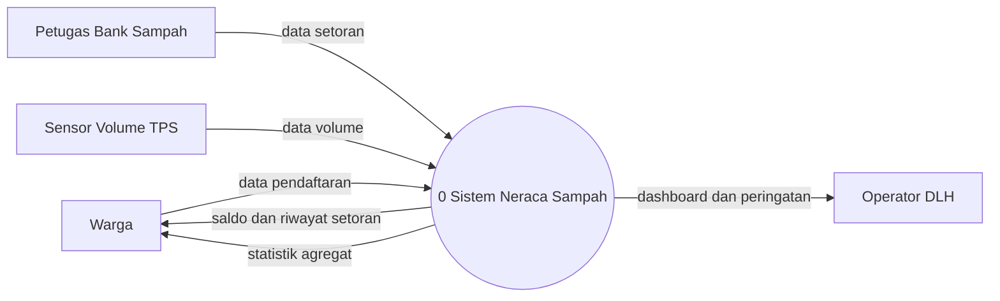
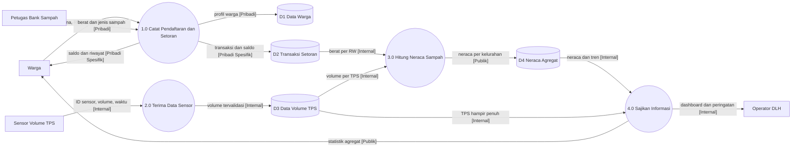
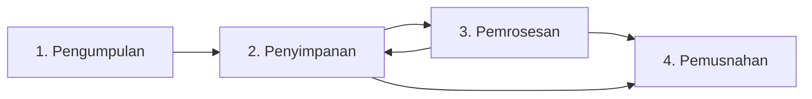
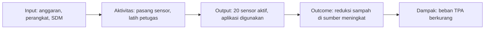

# MODUL 3 — TATA KELOLA DATA DAN PERENCANAAN IMPLEMENTASI

**Mata Kuliah:** Teknologi Smart City (ET234504)  
**Departemen:** Teknologi Informasi, ITS  
**Beban Praktikum:** 1 SKS  
**Semester:** 5  
**Tahap:** Perancangan *Proof of Concept* (PoC)

---

## 1. Tujuan Pembelajaran

Setelah mempelajari modul ini, mahasiswa diharapkan mampu:

- Menyusun *Data Flow Diagram* (DFD) dan memberi label klasifikasi data pada setiap aliran.
- Memetakan siklus hidup data mulai dari pengumpulan sampai pemusnahan.
- Menentukan kontrol keamanan teknis pada setiap lapisan arsitektur.
- Menerapkan prinsip Undang-Undang Pelindungan Data Pribadi dan etika pemanfaatan data warga dalam rancangan.
- Mengidentifikasi risiko keamanan, privasi, dan etika beserta mitigasinya.
- Menyusun pembagian peran antarinstansi dan mengidentifikasi regulasi daerah yang mendukung.
- Menyusun roadmap implementasi tiga tahap yang bertanggal.
- Menghitung estimasi biaya berdasarkan harga nyata.
- Merumuskan rencana keberlanjutan dan tiga KPI dampak yang terukur.

---

## 2. Pendahuluan

Modul 1 menghasilkan isu prioritas yang tervalidasi beserta pemetaan stakeholder dan pilar Kota Cerdas. Modul 2 menerjemahkan isu tersebut menjadi kebutuhan sistem, memilih teknologi dengan *Weighted Decision Matrix*, dan menyusun arsitektur empat lapis.

Arsitektur yang sudah disusun baru menjelaskan **komponen apa** yang digunakan. Sebelum solusi dapat diusulkan, ada dua pertanyaan yang masih harus dijawab:

1. **Bagaimana data dikelola?** Data apa yang mengalir, siapa yang boleh mengaksesnya, berapa lama disimpan, dan apa risikonya bagi warga.
2. **Bagaimana solusi diterapkan?** Siapa yang bertanggung jawab, kapan setiap tahap dijalankan, berapa biayanya, dan bagaimana keberhasilannya diukur.

Modul ini membahas kedua pertanyaan tersebut dalam dua bagian:

| Bagian | Topik | Tugas |
|---|---|---|
| A | Alur data dan tata kelola data | T3.1, T3.2 |
| B | Roadmap implementasi, biaya, dan KPI | T3.3, T3.4 |

> **Prinsip keterlacakan:** setiap luaran modul ini harus dapat ditelusuri ke luaran sebelumnya. Aliran data diturunkan dari arsitektur Modul 2, pembagian peran diturunkan dari pemetaan stakeholder Modul 1.4, dan baseline KPI diturunkan dari data isu Modul 1.

Materi yang sudah dibahas di modul sebelumnya, seperti arsitektur empat lapis, matriks Mendelow, dan kesiapan implementasi, tidak dijelaskan ulang. Bagian yang relevan cukup dirujuk dan dilanjutkan.

### Kasus Ilustrasi

Seluruh contoh dalam modul ini melanjutkan kasus persampahan Kota Surabaya dari Modul 1.3 dan 1.4. Solusi yang digunakan sebagai ilustrasi adalah **sistem neraca sampah berbasis data** dengan komponen berikut:

- sensor volume pada TPS di wilayah pilot;
- aplikasi pencatatan setoran untuk bank sampah tingkat RW;
- dashboard neraca sampah untuk DLH Kota Surabaya;
- halaman statistik agregat untuk publik.

Rancangan, angka, dan nama komponen pada contoh bersifat ilustratif. Kelompok harus menggunakan rancangan dan data milik kelompok sendiri.

---

# BAGIAN A — ALUR DATA DAN TATA KELOLA DATA

## 3. Data Flow Diagram

### 3.1 Konsep DFD

*Data Flow Diagram* (DFD) menggambarkan **pergerakan data** di dalam sistem: dari mana data berasal, proses apa yang mengolahnya, di mana data disimpan, dan ke mana data dikirim.

DFD berbeda dari diagram arsitektur pada Modul 2:

| Diagram arsitektur (Modul 2) | Data Flow Diagram (Modul 3) |
|---|---|
| Menunjukkan **komponen teknologi** dan lapisannya | Menunjukkan **data** dan proses yang mengolahnya |
| Contoh elemen: sensor, LoRaWAN, broker MQTT, basis data | Contoh elemen: "data volume TPS", "proses hitung neraca" |
| Menjawab: sistem dibangun dari apa? | Menjawab: data apa yang mengalir dan ke mana? |

DFD tidak menunjukkan urutan waktu, percabangan logika, atau perulangan. Untuk kebutuhan tersebut digunakan diagram lain, seperti *flowchart* atau *sequence diagram*.

### 3.2 Notasi

Modul ini menggunakan notasi **Yourdon–DeMarco**. Gunakan satu notasi secara konsisten dan jangan mencampurnya dengan notasi lain, seperti Gane–Sarson.

| Elemen | Simbol | Fungsi | Aturan penamaan |
|---|---|---|---|
| Entitas eksternal | Persegi | Sumber atau tujuan data di luar sistem | Kata benda: *Warga*, *Operator DLH* |
| Proses | Lingkaran | Mengubah data masukan menjadi keluaran | Kata kerja + objek: *Hitung Neraca Sampah* |
| Penyimpanan data | Dua garis sejajar | Tempat data disimpan | Kata benda: *D1 Data Warga* |
| Aliran data | Panah berlabel | Perpindahan data | Nama data, bukan aksi: *berat setoran*, bukan *kirim data* |

> **Catatan alat bantu:** diagram dapat dibuat dengan draw.io, Lucidchart, atau Mermaid. Pada contoh Mermaid di modul ini, penyimpanan data digambarkan sebagai silinder karena Mermaid tidak menyediakan simbol dua garis sejajar. Simbol yang digunakan harus dijelaskan dalam legenda.

Aturan dasar DFD:

- Setiap proses harus memiliki minimal satu aliran masuk dan satu aliran keluar.
- Data tidak boleh mengalir langsung dari entitas eksternal ke penyimpanan data, atau dari penyimpanan ke penyimpanan. Aliran tersebut harus melalui proses.
- Setiap aliran harus diberi label.
- Penomoran proses pada level 0 menggunakan 1.0, 2.0, 3.0, dan seterusnya.

### 3.3 Level DFD yang Digunakan

Praktikum ini hanya mewajibkan dua level:

| Level | Isi | Fungsi |
|---|---|---|
| **Diagram konteks** | Satu proses yang mewakili seluruh sistem, dikelilingi entitas eksternal | Menunjukkan batas sistem dan pihak yang berinteraksi |
| **DFD level 0** | Proses utama, penyimpanan data, dan aliran antarproses | Menunjukkan cara data diolah di dalam sistem |

Pemecahan ke level 1 atau level yang lebih dalam tidak diwajibkan.

**Contoh diagram konteks:**

### 3.4 Pelabelan Klasifikasi Data

Setiap aliran data pada DFD level 0 diberi **label klasifikasi**. Label ini menentukan kontrol keamanan dan aturan privasi yang berlaku.

| Label | Definisi | Contoh |
|---|---|---|
| **Publik** | Boleh dibuka kepada umum tanpa risiko bagi individu | Total sampah per kelurahan per bulan |
| **Internal** | Data operasional non-pribadi yang hanya digunakan oleh pengelola | Volume TPS per jam, status perangkat |
| **Pribadi** | Data yang mengidentifikasi atau dapat mengidentifikasi seseorang | Nama, nomor HP, alamat, riwayat setoran per orang |
| **Pribadi Spesifik** | Kategori dalam UU PDP Pasal 4 ayat (2) yang berdampak lebih besar jika bocor | Kesehatan, biometrik, genetika, catatan kejahatan, data anak, keuangan pribadi |

Prinsip pelabelan:

- **Data gabungan dapat mengidentifikasi seseorang.** Nomor RW ditambah jadwal setor ditambah jenis sampah dapat mengarah ke satu rumah tangga. Jika kombinasi tersebut berpotensi mengidentifikasi, gunakan label **Pribadi**.
- **Jika ragu, pilih label yang lebih tinggi.** Misalnya, saldo tabungan bank sampah dapat ditafsirkan sebagai data keuangan pribadi. Pada contoh ini saldo diperlakukan sebagai **Pribadi Spesifik**.
- **Agregasi dapat menurunkan klasifikasi.** Data setoran per orang berlabel Pribadi, sedangkan total setoran per RW dapat berlabel Publik apabila jumlah rumah tangganya cukup besar (lihat Bagian 6).

**Contoh DFD level 0 berlabel:**

Pada contoh tersebut, data berat setoran yang semula berlabel **Pribadi** berubah menjadi **Internal** setelah dijumlahkan per RW, lalu menjadi **Publik** setelah diolah menjadi neraca per kelurahan. Perubahan klasifikasi seperti ini harus terlihat pada DFD.

---

## 4. Siklus Hidup Data

### 4.1 Empat Tahap Siklus Hidup

Siklus hidup data menjelaskan perlakuan terhadap data sejak dikumpulkan sampai dimusnahkan. Modul ini menggunakan empat tahap:

| Tahap | Pertanyaan kunci |
|---|---|
| **Pengumpulan** | Data apa yang dikumpulkan, dari siapa, dengan cara apa, dan atas dasar apa? Apakah semua data benar-benar diperlukan? |
| **Penyimpanan** | Di mana data disimpan, dalam bentuk apa, siapa yang dapat mengakses, dan bagaimana data dilindungi? |
| **Pemrosesan** | Data diolah untuk tujuan apa? Apakah tujuan tersebut sama dengan tujuan saat data dikumpulkan? Siapa yang menerima hasilnya? |
| **Pemusnahan** | Berapa lama data disimpan (masa retensi), dan bagaimana data dihapus atau dianonimkan setelah masa tersebut berakhir? |

Pemrosesan dapat menghasilkan data baru yang disimpan kembali, misalnya data agregat. Karena itu, terdapat panah balik dari pemrosesan ke penyimpanan.

### 4.2 Masa Retensi dan Metode Pemusnahan

Masa retensi adalah **keputusan desain** yang harus dijustifikasi, bukan angka yang ditetapkan tanpa alasan. Dasar penetapannya dapat berupa:

- kebutuhan layanan, misalnya data transaksi diperlukan selama akun warga aktif;
- kebutuhan analisis, misalnya data volume mentah diperlukan untuk melihat pola musiman selama satu tahun;
- kewajiban hukum, misalnya ketentuan arsip pemerintah apabila data tersebut menjadi arsip dinas.

Metode pemusnahan:

| Metode | Penjelasan | Catatan |
|---|---|---|
| Penghapusan aman | Data dihapus sehingga tidak dapat dipulihkan | Berlaku juga untuk salinan cadangan (*backup*) |
| Anonimisasi | Identitas dihilangkan secara permanen sehingga data tidak dapat dikaitkan kembali dengan individu | Data yang benar-benar anonim tidak lagi tergolong data pribadi |
| Pemusnahan fisik | Media penyimpanan dihancurkan | Untuk perangkat yang tidak lagi digunakan |

> **Pseudonimisasi bukan anonimisasi.** Mengganti nama dengan kode masih memungkinkan data dikaitkan kembali selama tabel kunci tersedia. Data hasil pseudonimisasi tetap tergolong data pribadi.

### 4.3 Contoh Tabel Siklus Hidup Data

Diagram siklus hidup dilengkapi dengan tabel per kelompok data. Contoh untuk data **D1 Data Warga** dan **D3 Data Volume TPS**:

| Tahap | D1 Data Warga (Pribadi) | D3 Data Volume TPS (Internal) |
|---|---|---|
| Pengumpulan | Formulir pendaftaran di aplikasi: nama, RW, nomor HP. **Tidak** meminta NIK atau foto KTP karena tidak diperlukan untuk layanan. Dasar: persetujuan warga. | Sensor ultrasonik mengirim volume setiap 15 menit melalui jaringan seluler. |
| Penyimpanan | Basis data terenkripsi di server pemerintah kota. Akses hanya untuk admin DLH dan petugas bank sampah RW terkait. | Basis data deret waktu (*time-series*) di server yang sama. Akses untuk operator DLH dan Diskominfo. |
| Pemrosesan | Identifikasi pemilik transaksi dan penghitungan saldo. Tidak digunakan untuk tujuan lain tanpa persetujuan baru. | Penghitungan tingkat keterisian dan peringatan TPS hampir penuh. Agregasi harian untuk neraca. |
| Pemusnahan | Dihapus 1 tahun setelah akun nonaktif atau saat warga meminta penghapusan. Riwayat setoran dianonimkan untuk statistik. | Data mentah disimpan 1 tahun, kemudian dihapus. Agregat harian disimpan permanen. |

---

## 5. Keamanan Siber dan Kontrol Teknis

### 5.1 Prinsip CIA

Keamanan informasi dinilai berdasarkan tiga aspek:

| Aspek | Pengertian | Contoh ancaman pada sistem Smart City |
|---|---|---|
| **Confidentiality** (kerahasiaan) | Data hanya dapat diakses oleh pihak yang berwenang | Basis data warga diakses pihak luar |
| **Integrity** (integritas) | Data tidak diubah tanpa izin dan tetap akurat | Nilai sensor dipalsukan sehingga neraca menjadi salah |
| **Availability** (ketersediaan) | Sistem dan data tersedia saat dibutuhkan | Server tidak dapat diakses sehingga peringatan TPS penuh tidak terkirim |

### 5.2 Kontrol Teknis per Lapisan Arsitektur

Kontrol keamanan ditempatkan pada setiap lapisan arsitektur empat lapis dari Modul 2. Kontrol harus dipilih berdasarkan risiko yang ada pada sistem, bukan disalin seluruhnya dari daftar.

| Lapisan | Contoh kontrol teknis | Aspek CIA |
|---|---|---|
| **Perangkat** | Kredensial unik per perangkat (bukan satu kata sandi untuk semua perangkat); mengganti kredensial bawaan pabrik; pembaruan *firmware*; casing yang terkunci | C, I |
| **Jaringan** | Enkripsi transmisi (TLS 1.2 atau lebih tinggi, termasuk MQTT over TLS); pemisahan jaringan perangkat dan jaringan admin; *firewall* | C, I |
| **Platform** | Enkripsi data saat disimpan (*encryption at rest*); kontrol akses berbasis peran (RBAC); log audit akses; *backup* terjadwal dan uji pemulihan; validasi rentang nilai data sensor | C, I, A |
| **Aplikasi** | Autentikasi; autentikasi multifaktor (MFA) untuk akun admin; batas percobaan login; validasi masukan; sesi kedaluwarsa otomatis | C, I |

Selain kontrol teknis, diperlukan kontrol **organisasional**, seperti prosedur penanganan insiden, pelatihan petugas, dan pembagian kewenangan. Kontrol organisasional dibahas lebih lanjut pada Bagian B melalui pembagian peran.

> **Rujukan sektor pemerintah:** sistem milik pemerintah daerah termasuk Sistem Pemerintahan Berbasis Elektronik (SPBE). Pedoman keamanannya diatur oleh Badan Siber dan Sandi Negara (BSSN), antara lain melalui Peraturan BSSN Nomor 4 Tahun 2021.

---

## 6. Privasi, UU PDP, dan Etika Pemanfaatan Data Warga

### 6.1 UU Nomor 27 Tahun 2022 tentang Pelindungan Data Pribadi

UU PDP mengatur pemrosesan data pribadi di Indonesia, termasuk oleh instansi pemerintah. Bagian yang paling relevan untuk perancangan sistem Smart City:

**a. Peran para pihak**

| Peran | Pengertian | Contoh |
|---|---|---|
| Subjek data pribadi | Orang yang datanya diproses | Warga pengguna aplikasi bank sampah |
| Pengendali data pribadi | Pihak yang menentukan tujuan dan mengendalikan pemrosesan | DLH Kota Surabaya |
| Prosesor data pribadi | Pihak yang memproses data atas nama pengendali | Diskominfo sebagai pengelola server, atau vendor *cloud* |

**b. Dasar pemrosesan.** Pemrosesan data pribadi harus memiliki dasar yang sah. Dasar yang umum digunakan pada layanan Smart City:

- **persetujuan** yang sah secara eksplisit dari subjek data, misalnya warga mendaftar secara sukarela di aplikasi;
- **pelaksanaan tugas** dalam rangka kepentingan umum, pelayanan publik, atau kewenangan pengendali berdasarkan peraturan perundang-undangan.

Dasar pemrosesan harus dinyatakan pada tahap pengumpulan dalam tabel siklus hidup data.

**c. Prinsip pemrosesan yang diterapkan dalam rancangan**

| Prinsip | Penerapan dalam rancangan |
|---|---|
| Terbatas dan spesifik (minimisasi) | Hanya kumpulkan data yang diperlukan untuk fungsi sistem |
| Sesuai tujuan | Data tidak digunakan untuk tujuan lain di luar tujuan yang diberitahukan |
| Transparan | Warga diberi tahu data apa yang dikumpulkan dan untuk apa |
| Akurat dan mutakhir | Warga dapat memperbarui data miliknya |
| Aman | Kontrol teknis pada Bagian 5 |
| Retensi terbatas | Data dimusnahkan setelah masa retensi berakhir |
| Akuntabel | Pemrosesan tercatat dan dapat dibuktikan, misalnya melalui log audit |

**d. Hak subjek data** yang perlu difasilitasi oleh sistem, antara lain hak memperoleh informasi, mengakses dan memperoleh salinan, memperbaiki, menghapus, dan menarik persetujuan. Hak ini perlu diterjemahkan menjadi fitur atau prosedur, misalnya menu *Hapus Akun* di aplikasi.

**e. Kewajiban penting bagi pengendali**

- Menyampaikan pemberitahuan tertulis kepada subjek data dan lembaga pelindungan data pribadi paling lambat **3 × 24 jam** apabila terjadi kegagalan pelindungan data pribadi.
- Melakukan **penilaian dampak pelindungan data pribadi** untuk pemrosesan berisiko tinggi, misalnya pemrosesan data pribadi spesifik, pemrosesan skala besar, atau pemantauan sistematis.
- Menunjuk **pejabat atau petugas pelindungan data pribadi** apabila pemrosesan dilakukan untuk pelayanan publik, melibatkan pemantauan sistematis berskala besar, atau melibatkan data pribadi spesifik berskala besar.

### 6.2 Etika Pemanfaatan Data Warga

Pemrosesan yang sah secara hukum belum tentu etis. Prinsip etika yang digunakan dalam modul ini:

| Prinsip | Pertanyaan pemeriksa | Contoh pelanggaran |
|---|---|---|
| **Proporsionalitas** | Apakah data yang dikumpulkan sebanding dengan manfaat layanan? | Memasang kamera pengenal wajah di TPS hanya untuk mendeteksi pembuang sampah sembarangan |
| **Transparansi** | Apakah warga memahami data apa yang dikumpulkan dan digunakan untuk apa? | Kebijakan privasi panjang dengan bahasa hukum yang sulit dipahami |
| **Keadilan** | Apakah sistem merugikan kelompok tertentu? | Layanan hanya dapat diakses melalui *smartphone* sehingga warga lansia tidak terlayani |
| **Tidak menstigmatisasi** | Apakah informasi yang ditampilkan dapat mempermalukan warga atau wilayah? | Mempublikasikan peringkat RT dengan setoran terendah beserta nama ketua RT |
| **Akuntabilitas** | Apakah jelas siapa yang bertanggung jawab jika terjadi kesalahan? | Peringatan otomatis yang salah tanpa jalur koreksi |

**Agregasi untuk publikasi.** Data yang dipublikasikan sebaiknya diagregasi sampai tingkat yang tidak memungkinkan identifikasi individu. Salah satu aturan sederhana adalah tidak menampilkan angka untuk kelompok yang anggotanya kurang dari ambang tertentu, misalnya kurang dari 10 rumah tangga. Ambang tersebut merupakan keputusan desain yang perlu dijustifikasi.

---

## 7. Identifikasi Risiko dan Mitigasi

### 7.1 Penilaian Risiko

Risiko dinilai dengan matriks **3 × 3** berdasarkan kemungkinan terjadi dan dampaknya.

| Skor | Kemungkinan | Dampak |
|---:|---|---|
| 1 | Rendah: jarang terjadi atau membutuhkan kondisi khusus | Rendah: gangguan kecil, mudah dipulihkan, tidak merugikan warga |
| 2 | Sedang: dapat terjadi dalam masa operasional | Sedang: layanan terganggu atau sebagian kecil data warga terdampak |
| 3 | Tinggi: sangat mungkin terjadi | Tinggi: kebocoran data pribadi dalam jumlah besar, kerugian warga, atau layanan berhenti |

$$
\text{Skor Risiko} = \text{Kemungkinan} \times \text{Dampak}
$$

| Skor risiko | Level | Perlakuan |
|---|---|---|
| 1–2 | Rendah | Dipantau |
| 3–4 | Sedang | Dimitigasi sesuai kemampuan |
| 6–9 | Tinggi | Wajib dimitigasi sebelum sistem dioperasikan |

Strategi mitigasi:

- **Hindari:** menghilangkan sumber risiko, misalnya tidak mengumpulkan NIK.
- **Kurangi:** menurunkan kemungkinan atau dampak, misalnya dengan enkripsi.
- **Alihkan:** memindahkan sebagian risiko ke pihak lain, misalnya melalui perjanjian tingkat layanan (SLA) dengan penyedia *cloud*.
- **Terima:** menerima risiko rendah dengan pemantauan.

### 7.2 Sumber Identifikasi Risiko

Risiko diidentifikasi dengan menelusuri DFD dan tabel siklus hidup data:

- setiap aliran data berlabel **Pribadi** atau **Pribadi Spesifik**;
- setiap penyimpanan data;
- setiap tahap siklus hidup, terutama pengumpulan dan pemusnahan;
- setiap perangkat yang dipasang di ruang publik;
- setiap informasi yang ditampilkan kepada publik.

### 7.3 Contoh Tabel Risiko dan Mitigasi

| ID | Lokasi (aliran/tahap) | Risiko | Kategori | K | D | Skor | Level | Mitigasi | Penanggung jawab |
|---|---|---|---|:-:|:-:|:-:|---|---|---|
| R1 | D1 Data Warga | Kebocoran data warga akibat akses tidak sah ke basis data | Keamanan, Privasi | 2 | 3 | 6 | Tinggi | Kurangi: enkripsi saat disimpan, RBAC, MFA untuk admin, log audit; siapkan prosedur pemberitahuan 3 × 24 jam | Diskominfo (teknis), DLH (pengendali) |
| R2 | Pengumpulan D1 | Pengumpulan data berlebihan, misalnya NIK dan foto KTP, tanpa kebutuhan layanan | Privasi | 3 | 2 | 6 | Tinggi | Hindari: formulir hanya meminta nama, RW, dan nomor HP | DLH |
| R3 | Aliran sensor → 2.0 | Nilai volume diubah atau dipalsukan saat transmisi | Keamanan (integritas) | 2 | 2 | 4 | Sedang | Kurangi: MQTT over TLS, kredensial unik per perangkat, validasi rentang nilai | Diskominfo |
| R4 | 4.0 → Warga (statistik publik) | Warga dapat diidentifikasi dari data setoran wilayah kecil | Privasi, Etika | 2 | 2 | 4 | Sedang | Kurangi: agregasi minimal per kelurahan; sembunyikan angka kelompok di bawah 10 rumah tangga | Diskominfo |
| R5 | Publikasi capaian RT/RW | Stigmatisasi warga atau wilayah dengan capaian rendah | Etika | 2 | 2 | 4 | Sedang | Hindari: tidak menampilkan peringkat terendah; tampilkan capaian dan kemajuan wilayah | DLH, Kelurahan |
| R6 | Sensor di TPS | Perangkat rusak, dicuri, atau dirusak sehingga data hilang | Operasional (ketersediaan) | 3 | 1 | 3 | Sedang | Kurangi: casing terkunci, pemantauan sinyal *heartbeat*, stok cadangan perangkat | DLH |
| R7 | Pemusnahan D1 | Data warga tetap tersimpan setelah akun nonaktif | Privasi | 2 | 2 | 4 | Sedang | Kurangi: penghapusan otomatis sesuai masa retensi, termasuk pada *backup* | Diskominfo |
| R8 | Server platform | Server tidak dapat diakses sehingga data sensor tidak terekam | Keamanan (ketersediaan) | 1 | 2 | 2 | Rendah | Terima dan kurangi: *buffer* data lokal pada perangkat, *backup* harian | Diskominfo |

K = kemungkinan, D = dampak.

---

# BAGIAN B — ROADMAP IMPLEMENTASI, BIAYA, DAN KPI

## 8. Model Tata Kelola dan Pembagian Peran

### 8.1 Model Tata Kelola

Solusi Smart City umumnya melibatkan lebih dari satu instansi. Model tata kelola menentukan siapa yang mengoordinasikan dan siapa yang mengambil keputusan.

| Model | Ciri | Kelebihan | Kekurangan |
|---|---|---|---|
| **Terpusat** | Satu instansi menjadi pemilik dan pengelola seluruh sistem | Keputusan cepat dan tanggung jawab jelas | Beban bertumpu pada satu instansi; instansi lain kurang terlibat |
| **Kolaboratif** | Beberapa instansi berbagi peran sesuai tugas dan fungsi, dengan satu koordinator | Memanfaatkan keahlian setiap instansi | Membutuhkan koordinasi dan kesepakatan formal |

Pada sistem pemerintah daerah, pola yang umum adalah **dinas teknis sebagai pemilik layanan** dan **Diskominfo sebagai pengelola infrastruktur TIK**. Pola ini sejalan dengan pembagian peran pengendali dan prosesor data pada Bagian 6.1.

### 8.2 Matriks RACI

Pembagian peran disusun dengan **matriks RACI**. Daftar aktor diambil dari pemetaan stakeholder Modul 1.4, terutama aktor pada kuadran *Manage Closely* dan *Keep Informed*.

| Kode | Peran | Aturan |
|---|---|---|
| **R** (*Responsible*) | Pelaksana pekerjaan | Minimal satu per aktivitas |
| **A** (*Accountable*) | Penanggung jawab akhir yang menyetujui | **Tepat satu** per aktivitas |
| **C** (*Consulted*) | Dimintai masukan sebelum keputusan diambil | Komunikasi dua arah |
| **I** (*Informed*) | Diberi tahu hasilnya | Komunikasi satu arah |

**Contoh:**

| Aktivitas | DLH | Diskominfo | Bappeda | Bagian Hukum | Kelurahan | Bank Sampah RW |
|---|:-:|:-:|:-:|:-:|:-:|:-:|
| Penetapan kebijakan dan regulasi insentif pemilahan | A | I | C | R | C | C |
| Perencanaan dan penganggaran program | A | C | R | I | I | I |
| Pengadaan dan pemasangan sensor | A | R | I | I | C | I |
| Pengelolaan server, jaringan, dan keamanan | C | A/R | I | I | I | I |
| Pencatatan setoran warga | A | I | I | I | I | R |
| Pelindungan data pribadi warga | A | R | I | C | I | R |
| Pemantauan KPI dan pelaporan | A/R | C | I | I | I | I |

Periksa matriks dengan aturan berikut:

- Setiap baris memiliki tepat satu **A**.
- Tidak ada baris tanpa **R**.
- Aktor yang terlalu banyak mendapat **A** atau **R** menunjukkan beban kerja yang menumpuk.
- Aktor yang hanya mendapat **I** perlu diperiksa ulang: apakah keterlibatannya memang hanya sebatas diberi informasi?

### 8.3 Regulasi Pendukung

Solusi harus memiliki dasar regulasi agar dapat dijalankan oleh pemerintah daerah. Regulasi dikelompokkan berdasarkan tingkatnya:

| Tingkat | Fungsi | Contoh |
|---|---|---|
| Nasional – sektor | Mengatur urusan yang ditangani solusi | UU 18/2008 tentang Pengelolaan Sampah; PP 81/2012 tentang Pengelolaan Sampah Rumah Tangga dan Sampah Sejenis Sampah Rumah Tangga |
| Nasional – TIK dan data | Mengatur sistem elektronik dan data pemerintah | UU 27/2022 tentang PDP; PP 71/2019 tentang Penyelenggaraan Sistem dan Transaksi Elektronik; Perpres 95/2018 tentang SPBE; Perpres 39/2019 tentang Satu Data Indonesia |
| Daerah | Memberi kewenangan dan mekanisme operasional di kota | Perda, Peraturan Wali Kota, atau Keputusan Wali Kota terkait sektor dan Smart City |

**Cara menelusuri regulasi daerah:**

1. Buka portal Jaringan Dokumentasi dan Informasi Hukum (JDIH) pemerintah kota masing-masing.
2. Cari dengan kata kunci sektor (misalnya *sampah*, *kebersihan*, *retribusi*) dan kata kunci TIK (misalnya *smart city*, *SPBE*, *satu data*).
3. Periksa status regulasi: **masih berlaku, sudah diubah, atau sudah dicabut**.
4. Catat pasal yang relevan dengan solusi.

Hasil penelusuran disusun dalam tabel:

| Regulasi | Nomor dan tahun | Status | Pasal relevan | Relevansi terhadap solusi |
|---|---|---|---|---|
| *nama regulasi* | *nomor/tahun* | *berlaku/diubah/dicabut* | *pasal* | *bagaimana regulasi ini mendukung atau membatasi solusi* |

Jika regulasi yang dibutuhkan **belum tersedia**, misalnya regulasi insentif pemilahan tingkat RT/RW pada kasus Surabaya (Modul 1.4), kondisi tersebut dicatat sebagai **prasyarat** dalam roadmap, bukan diabaikan.

---

## 9. Roadmap Implementasi

### 9.1 Tiga Tahap Implementasi

Roadmap disusun dalam tiga tahap. Setiap tahap memperluas cakupan berdasarkan bukti dari tahap sebelumnya.

| Tahap | Tujuan | Cakupan umum |
|---|---|---|
| **1. Pilot** | Membuktikan solusi bekerja pada kondisi nyata | Wilayah kecil, misalnya satu atau dua kelurahan |
| **2. Perluasan terbatas** | Menguji solusi pada skala dan keragaman wilayah yang lebih besar | Beberapa kecamatan |
| **3. Skala kota** | Menerapkan solusi ke seluruh wilayah dan mengintegrasikannya ke sistem kota | Seluruh kota |

Setiap tahap harus memuat:

- **tanggal mulai dan selesai** (bulan dan tahun);
- **cakupan** wilayah atau pengguna;
- **aktivitas utama**;
- **luaran** tahap tersebut;
- **kriteria lanjut**, yaitu syarat terukur untuk melanjutkan ke tahap berikutnya.

> **Siklus anggaran daerah:** program pemerintah daerah didanai melalui APBD yang direncanakan pada tahun sebelumnya (melalui Musrenbang, RKPD, dan KUA-PPAS). Tanggal tahap yang didanai APBD harus memperhitungkan siklus ini.

### 9.2 Contoh Roadmap

| Tahap | Periode | Cakupan | Aktivitas utama | Luaran | Kriteria lanjut |
|---|---|---|---|---|---|
| **0. Persiapan** | Jan–Mar 2027 | — | Penyusunan regulasi insentif (prasyarat), penilaian dampak pelindungan data pribadi, pengadaan | Draf Peraturan Wali Kota, dokumen penilaian dampak, kontrak pengadaan | Regulasi dan dokumen penilaian dampak disetujui |
| **1. Pilot** | Apr–Sep 2027 | 2 kelurahan, 20 TPS, 10 bank sampah | Pemasangan sensor, pelatihan petugas, pengukuran baseline bulan pertama | Sistem berjalan; data baseline terukur | Data sensor terkirim ≥ 95% dari jadwal; KPI 1 di wilayah pilot naik dari baseline |
| **2. Perluasan terbatas** | Okt 2027–Sep 2028 | 3 kecamatan | Penambahan perangkat, integrasi ke portal data kota | Dashboard tingkat kecamatan | KPI 1–3 mencapai target tahap 2; biaya per TPS sesuai estimasi ±20% |
| **3. Skala kota** | Okt 2028–Des 2029 | Seluruh kota | Perluasan bertahap, serah terima operasional penuh ke DLH | Sistem neraca sampah kota | — |

Tahap persiapan dapat ditambahkan sebelum tahap pilot apabila terdapat prasyarat yang harus dipenuhi lebih dulu. Tahap persiapan tidak dihitung sebagai salah satu dari tiga tahap implementasi.

---

## 10. Estimasi Biaya

### 10.1 Komponen Biaya

| Komponen | Pengertian | Contoh |
|---|---|---|
| **Pengadaan** (*CAPEX*) | Biaya satu kali di awal untuk memperoleh aset | Perangkat sensor, timbangan digital, jasa pengembangan aplikasi, pelatihan awal |
| **Operasional** (*OPEX*) | Biaya rutin agar sistem tetap berjalan | Paket data seluler, sewa server atau *cloud*, honor operator |
| **Pemeliharaan** | Biaya rutin untuk menjaga dan memperbaiki aset | Penggantian perangkat rusak, pembaruan aplikasi, kalibrasi |

Biaya dihitung dalam bentuk **total biaya kepemilikan** (*Total Cost of Ownership*/TCO) selama periode tertentu, misalnya tiga tahun, bukan hanya biaya pengadaan.

$$
\text{TCO} = \text{CAPEX} + \sum_{t=1}^{n} \left(\text{OPEX}_t + \text{Pemeliharaan}_t\right)
$$

$$
\text{Total Anggaran} = \text{TCO} \times (1 + c)
$$

dengan:

- $n$: jumlah tahun periode perhitungan;
- $c$: persentase cadangan (*contingency*) untuk ketidakpastian harga, misalnya 10%.

### 10.2 Sumber Harga Nyata

Estimasi biaya harus menggunakan **harga nyata yang dapat diverifikasi**, bukan perkiraan tanpa dasar.

| Sumber | Digunakan untuk |
|---|---|
| Katalog elektronik pengadaan pemerintah (e-Katalog LKPP/INAPROC) | Perangkat keras dan jasa yang tersedia di katalog pemerintah |
| Standar Satuan Harga (SSH) pemerintah kota | Honor, perjalanan, dan barang umum sesuai standar daerah |
| Halaman harga resmi atau kalkulator harga penyedia layanan | Layanan *cloud* dan paket data |
| Toko resmi atau distributor | Komponen yang tidak tersedia di katalog pemerintah |

Setiap baris biaya harus mencantumkan **sumber dan tanggal akses**. Asumsi, misalnya biaya pemeliharaan 10% dari CAPEX per tahun, harus ditulis secara eksplisit sebagai asumsi.

### 10.3 Contoh Perhitungan

> Angka berikut **bersifat ilustratif** untuk menunjukkan cara menghitung, bukan harga acuan. Kelompok wajib menggunakan harga nyata beserta sumbernya.

**Pengadaan (tahap pilot)**

| Item | Jumlah | Harga satuan (Rp) | Subtotal (Rp) | Sumber |
|---|---:|---:|---:|---|
| Node sensor volume (mikrokontroler, sensor, casing, baterai) | 20 | 1.500.000 | 30.000.000 | *sumber, tanggal akses* |
| Timbangan digital bank sampah | 10 | 2.000.000 | 20.000.000 | *sumber, tanggal akses* |
| Jasa pengembangan aplikasi dan dashboard | 1 paket | 60.000.000 | 60.000.000 | *sumber, tanggal akses* |
| Pelatihan petugas | 1 paket | 10.000.000 | 10.000.000 | *SSH kota* |
| **Total CAPEX** | | | **120.000.000** | |

**Operasional dan pemeliharaan per tahun**

| Item | Perhitungan | Per tahun (Rp) |
|---|---|---:|
| Paket data seluler sensor | 20 × Rp50.000 × 12 bulan | 12.000.000 |
| Sewa server | Rp1.000.000 × 12 bulan | 12.000.000 |
| Honor operator data | 1 orang × Rp3.000.000 × 12 bulan | 36.000.000 |
| **Total OPEX** | | **60.000.000** |
| Pemeliharaan (asumsi 10% CAPEX) | 10% × Rp120.000.000 | 12.000.000 |

**Total tiga tahun**

$$
\begin{aligned}
\text{TCO} &= 120.000.000 + 3 \times (60.000.000 + 12.000.000) \\
&= 120.000.000 + 216.000.000 \\
&= 336.000.000
\end{aligned}
$$

$$
\text{Total Anggaran} = 336.000.000 \times 1{,}10 = \text{Rp}369.600.000
$$

Hasil perhitungan tersebut adalah biaya **tahap pilot selama tiga tahun**. Biaya tahap perluasan dan skala kota dapat diproyeksikan dengan pendekatan biaya per unit, misalnya biaya per TPS, dengan asumsi yang dinyatakan secara jelas.

---

## 11. Rencana Keberlanjutan

Banyak proyek Smart City berhenti setelah tahap pilot karena tidak memiliki rencana pendanaan dan pengelolaan jangka panjang. Rencana keberlanjutan menjawab pertanyaan: **apakah sistem tetap berjalan setelah tahap pilot dan setelah tim pengembang tidak lagi terlibat?**

| Aspek | Pertanyaan kunci | Contoh rencana |
|---|---|---|
| **Finansial** | Dari mana dana operasional dan pemeliharaan berasal setiap tahun? | OPEX dianggarkan dalam APBD rutin DLH mulai tahap 2; peluang dukungan CSR untuk perangkat |
| **Kelembagaan** | Instansi mana yang memiliki dan menjalankan sistem secara permanen? | Sistem ditetapkan sebagai aset DLH; tugas pengelolaan tercantum dalam regulasi |
| **Sumber daya manusia** | Siapa yang mengoperasikan dan memelihara sistem? Bagaimana pengetahuan dialihkan? | Pelatihan operator internal DLH; dokumentasi teknis; tidak bergantung pada satu vendor |
| **Teknis** | Apakah sistem dapat dipelihara dan dikembangkan? | Menggunakan standar terbuka; kode sumber diserahkan ke pemerintah kota |
| **Lingkungan** | Bagaimana dampak lingkungan perangkat dikelola? | Baterai dan perangkat rusak dikelola sebagai limbah elektronik |

---

## 12. KPI Dampak

### 12.1 Output, Outcome, dan Dampak

KPI harus mengukur **perubahan yang dihasilkan solusi**, bukan sekadar aktivitas yang dilakukan.

| Jenis | Contoh | Termasuk KPI dampak? |
|---|---|---|
| Output | Jumlah sensor terpasang, jumlah pengguna terdaftar | Tidak |
| Outcome | Persentase reduksi sampah di sumber | Ya |
| Dampak | Penurunan tonase sampah yang masuk ke TPA | Ya |

Indikator output tetap berguna untuk memantau pelaksanaan, tetapi **tidak dihitung sebagai KPI dampak** dalam tugas ini.

### 12.2 Kriteria SMART

Setiap KPI harus memenuhi kriteria SMART:

| Kriteria | Pengertian |
|---|---|
| **Specific** | Jelas apa yang diukur dan di wilayah mana |
| **Measurable** | Memiliki rumus, satuan, dan sumber data |
| **Achievable** | Target realistis terhadap baseline dan sumber daya |
| **Relevant** | Berkaitan langsung dengan isu prioritas dan akar masalah dari Modul 1 |
| **Time-bound** | Memiliki batas waktu yang sesuai dengan tahap roadmap |

### 12.3 Komponen KPI

Setiap KPI dituliskan dengan komponen berikut:

| Komponen | Penjelasan |
|---|---|
| Nama KPI | Nama indikator |
| Rumus | Cara menghitung beserta satuan |
| Baseline | Nilai awal sebelum solusi diterapkan, beserta sumber dan tahunnya |
| Target | Nilai yang ingin dicapai beserta batas waktunya |
| Sumber data | Asal data untuk mengukur KPI |
| Frekuensi | Seberapa sering KPI diukur |

> **Jika baseline belum tersedia** untuk wilayah pilot, baseline dapat diukur pada bulan pertama tahap pilot. Rencana pengukuran tersebut harus ditulis secara eksplisit. Baseline tidak boleh dikarang.

### 12.4 Contoh KPI

Target pada contoh berikut bersifat ilustratif.

| Komponen | KPI 1 | KPI 2 | KPI 3 |
|---|---|---|---|
| **Nama** | Persentase reduksi sampah di sumber | Tonase sampah wilayah pilot yang dikirim ke TPA | Partisipasi rumah tangga dalam bank sampah |
| **Rumus** | (sampah tereduksi di sumber ÷ total timbulan) × 100% | Rata-rata ton/hari sampah dari wilayah pilot yang masuk ke TPA Benowo | (rumah tangga aktif menyetor ≥ 1 kali/bulan ÷ total rumah tangga) × 100% |
| **Baseline** | 7,43% tingkat kota (Laporan Evaluasi DLH 2025, Modul 1.4); baseline wilayah pilot diukur pada bulan pertama | Diukur pada bulan pertama pilot dari data timbangan TPA | Diukur pada bulan pertama pilot dari data bank sampah |
| **Target** | 15% di wilayah pilot pada akhir tahap 1 (Sep 2027) | Turun 10% dari baseline pada akhir tahap 2 (Sep 2028) | 30% pada akhir tahap 2 (Sep 2028) |
| **Sumber data** | Aplikasi bank sampah dan data neraca sistem | Data timbangan TPA Benowo (DLH) | Aplikasi bank sampah dan data kependudukan kelurahan |
| **Frekuensi** | Bulanan | Bulanan | Bulanan |

Ketiga KPI berhubungan langsung dengan isu prioritas pada Modul 1.4, yaitu rendahnya reduksi sampah di sumber dan beban TPA yang melebihi kapasitas olah. ISO 37122 dan ITU-T Y.4903 dapat digunakan sebagai sumber inspirasi indikator Kota Cerdas, tetapi KPI tetap harus disesuaikan dengan solusi kelompok.

---

## 13. Kesalahan Umum

**Kesalahan 1: DFD berisi komponen teknologi.**  
Elemen seperti *LoRaWAN*, *MQTT*, atau *PostgreSQL* adalah komponen arsitektur, bukan elemen DFD. DFD berisi entitas, proses, penyimpanan, dan aliran data.

**Kesalahan 2: Aliran data tanpa label klasifikasi.**  
Setiap aliran harus memiliki nama data dan label klasifikasi. Tanpa label, risiko privasi tidak dapat diidentifikasi.

**Kesalahan 3: Mengumpulkan data "untuk berjaga-jaga".**  
Meminta NIK, foto KTP, atau lokasi GPS tanpa kebutuhan fungsional melanggar prinsip minimisasi dan menambah risiko.

**Kesalahan 4: Siklus hidup berhenti di penyimpanan.**  
Tahap pemusnahan sering terlewat. Setiap kelompok data harus memiliki masa retensi dan metode pemusnahan.

**Kesalahan 5: Mitigasi yang tidak spesifik.**  
"Meningkatkan keamanan" bukan mitigasi. Mitigasi harus menyebut kontrol yang konkret, misalnya "enkripsi AES-256 pada basis data D1 dan MFA untuk akun admin".

**Kesalahan 6: Lebih dari satu *Accountable* dalam satu aktivitas.**  
Jika dua instansi sama-sama menjadi penanggung jawab akhir, pada praktiknya tidak ada yang bertanggung jawab.

**Kesalahan 7: Roadmap tanpa tanggal atau tanpa kriteria lanjut.**  
"Tahap 1: pilot" tanpa periode dan tanpa syarat keberhasilan tidak dapat dievaluasi.

**Kesalahan 8: Harga tanpa sumber.**  
Setiap angka biaya harus dapat diverifikasi. Biaya yang hanya menghitung pengadaan tanpa operasional dan pemeliharaan tidak menggambarkan kebutuhan anggaran sebenarnya.

**Kesalahan 9: KPI berupa output.**  
"Terpasang 20 sensor" adalah output. KPI dampak mengukur perubahan kondisi, misalnya "reduksi sampah di sumber meningkat menjadi 15%".

**Kesalahan 10: Baseline dikarang.**  
Jika data baseline tidak tersedia, tuliskan rencana pengukurannya. Jangan mengisi angka yang tidak memiliki sumber.

---

## Daftar Pustaka

1. Badan Siber dan Sandi Negara. (2021). *Peraturan BSSN Nomor 4 Tahun 2021 tentang Pedoman Manajemen Keamanan Informasi Sistem Pemerintahan Berbasis Elektronik dan Standar Teknis dan Prosedur Keamanan Sistem Pemerintahan Berbasis Elektronik*. BSSN.
2. DAMA International. (2017). *DAMA-DMBOK: Data Management Body of Knowledge* (2nd ed.). Technics Publications.
3. DeMarco, T. (1979). *Structured Analysis and System Specification*. Yourdon Press.
4. Doran, G. T. (1981). There's a S.M.A.R.T. way to write management's goals and objectives. *Management Review, 70*(11), 35–36.
5. International Organization for Standardization. (2018). *ISO 31000:2018 Risk management — Guidelines*. ISO.
6. International Organization for Standardization. (2019). *ISO 37122:2019 Sustainable cities and communities — Indicators for smart cities*. ISO.
7. International Telecommunication Union. (2022). *Recommendation ITU-T Y.4903: Key performance indicators for smart sustainable cities to assess the achievement of the Sustainable Development Goals*. ITU.
8. Joint Task Force Transformation Initiative. (2012). *Guide for Conducting Risk Assessments* (NIST Special Publication 800-30 Rev. 1). National Institute of Standards and Technology.
9. Kementerian Komunikasi dan Digital Republik Indonesia. (2023). *Panduan Implementasi dan Masterplan Smart City Daerah*. Kemkomdigi RI.
10. Pemerintah Kota Surabaya — Dinas Lingkungan Hidup. (2025). *Laporan Evaluasi Tahunan Pengelolaan Persampahan Kota Surabaya 2025*. DLH Kota Surabaya.
11. Republik Indonesia. (2008). *Undang-Undang Nomor 18 Tahun 2008 tentang Pengelolaan Sampah*.
12. Republik Indonesia. (2012). *Peraturan Pemerintah Nomor 81 Tahun 2012 tentang Pengelolaan Sampah Rumah Tangga dan Sampah Sejenis Sampah Rumah Tangga*.
13. Republik Indonesia. (2018). *Peraturan Presiden Nomor 95 Tahun 2018 tentang Sistem Pemerintahan Berbasis Elektronik*.
14. Republik Indonesia. (2019). *Peraturan Pemerintah Nomor 71 Tahun 2019 tentang Penyelenggaraan Sistem dan Transaksi Elektronik*.
15. Republik Indonesia. (2019). *Peraturan Presiden Nomor 39 Tahun 2019 tentang Satu Data Indonesia*.
16. Republik Indonesia. (2022). *Undang-Undang Nomor 27 Tahun 2022 tentang Pelindungan Data Pribadi*.
17. W. K. Kellogg Foundation. (2004). *Logic Model Development Guide*. W. K. Kellogg Foundation.
