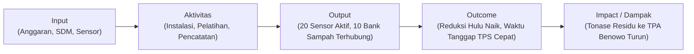

# MODUL 3.2 — ROADMAP IMPLEMENTASI, BIAYA, DAN KPI

**Mata Kuliah:** Teknologi Smart City (ET234504)  
**Departemen:** Teknologi Informasi, ITS  
**Beban Praktikum:** 1 SKS  
**Semester:** 5  
**Tahap:** Perancangan *Proof of Concept* (PoC) — Bagian 2

---

## 1. Tujuan Pembelajaran

Setelah mempelajari modul ini, mahasiswa diharapkan mampu:

- Menyusun pembagian peran antarinstansi menggunakan matriks RACI yang selaras dengan pemetaan *stakeholder* (Modul 1.4) serta peran Pengendali dan Prosesor Data (Modul 3.1) (T3.3).
- Menelusuri dan memverifikasi status keberlakuan regulasi pendukung tingkat nasional maupun daerah melalui portal JDIH (T3.3).
- Menyusun *roadmap* implementasi tiga tahap bertanggal beserta kriteria lanjut (*go/no-go gate*) dan kriteria serah terima akhir (T3.3).
- Menghitung estimasi biaya tiga tahun (*Total Cost of Ownership*/TCO) berbasis harga nyata serta membandingkannya dengan manfaat layanan (T3.4).
- Merumuskan rencana keberlanjutan lima aspek dan tiga *Key Performance Indicator* (KPI) dampak yang memenuhi kriteria SMART (T3.4).
- Mengintegrasikan seluruh luaran Modul 1 sampai Modul 3.2 secara konsisten ke dalam sistematika Proposal GEMASTIK Divisi Kota Cerdas dan naratif komunikasi rancangan.

---

## 2. Pendahuluan

Pada Modul 3.1, kelompok telah merancang aliran data (DFD Level 0), siklus hidup penyimpanan data (`D1`–`D4`), kontrol keamanan teknis, kepatuhan terhadap UU Pelindungan Data Pribadi (UU PDP), serta matriks mitigasi risiko.

Agar rancangan teknis dan tata kelola data tersebut layak diimplementasikan oleh pemerintah daerah, perancang sistem harus menjawab pertanyaan berikutnya: **siapa yang bertanggung jawab menjalankannya, regulasi apa yang menjadi dasar, kapan setiap tahapan dieksekusi, berapa biayanya dibanding manfaatnya, dan bagaimana dampak keberhasilannya diukur?**

Modul 3.2 membahas perencanaan implementasi tersebut melalui dua tugas praktikum dengan total **20 poin** (estimasi waktu pengerjaan kelompok 3 orang: ±80 menit):

| Kode Tugas & Poin | Fokus Materi & Luaran Wajib | *Sheet* Kerja Praktikum | Estimasi Waktu |
|---|---|---|---|
| **T3.3** (10 poin) | Matriks RACI Antarinstansi, Tabel Verifikasi Regulasi (Nasional & JDIH Daerah), serta *Roadmap* Implementasi 3 Tahap Bertanggal | `3.3 Tata Kelola & Roadmap` | ±40 menit |
| **T3.4** (10 poin) | Estimasi Biaya 3 Tahun (CAPEX, OPEX, Pemeliharaan, TCO & Perbandingan Manfaat), Rencana Keberlanjutan 5 Aspek, dan 3 KPI Dampak (SMART) | `3.4 Biaya, Keberlanjutan & KPI` | ±40 menit |

> **Prinsip keterlacakan (*traceability*):**
> - Aktor pada matriks RACI diturunkan dari *Stakeholder Mapping* (Modul 1.4) serta peran Pengendali dan Prosesor Data (Modul 3.1).
> - Prasyarat pada *roadmap* (seperti penyusunan DPIA dan uji keamanan) diturunkan dari mitigasi risiko tinggi pada Modul 3.1 (`T3.2`).
> - Komponen biaya diturunkan dari spesifikasi arsitektur (Modul 2) dan kontrol keamanan/privasi (Modul 3.1).
> - Rumus dan sumber data ketiga KPI dampak wajib merujuk pada penyimpanan data yang ada di DFD Level 0 (Modul 3.1) dan menjawab akar masalah dari Modul 1.3–1.4.

---

## 3. Model Tata Kelola, Matriks RACI, dan Regulasi Pendukung

### 3.1 Model Tata Kelola Antarinstansi

Solusi Smart City di lingkungan pemerintah daerah melibatkan lintas organisasi perangkat daerah (OPD) dan mitra masyarakat (Kementerian Komunikasi dan Informatika Republik Indonesia, 2021). Terdapat dua model utama:

| Model Tata Kelola | Karakteristik | Kelebihan & Keterbatasan |
|---|---|---|
| **Terpusat** (*Centralized*) | Satu dinas merangkap pemilik layanan sekaligus pengelola seluruh infrastruktur TIK | Pengambilan keputusan cepat pada skala kecil, tetapi membebani dinas teknis yang tidak memiliki keahlian infrastruktur siber/server. |
| **Kolaboratif Terkoordinasi** (*Federated / Collaborative*) | Dinas teknis bertindak sebagai pemilik proses bisnis layanan, sedangkan Diskominfo mengelola infrastruktur SPBE dan keamanan informasi | Selaras dengan arsitektur SPBE pemerintah daerah dan pemisahan peran Pengendali–Prosesor Data, namun memerlukan kejelasan pembagian peran (RACI). |

Pada kasus Sistem Neraca Sampah Kota Surabaya, digunakan **model kolaboratif terkoordinasi**:
- **Dinas Lingkungan Hidup (DLH) Kota Surabaya** bertindak sebagai *Service Owner* sekaligus **Pengendali Data Pribadi**.
- **Dinas Komunikasi dan Informatika (Diskominfo) Kota Surabaya** bertindak sebagai *Technical Infrastructure Owner* SPBE sekaligus **Prosesor Data Pribadi**.
- **Bappedalitbang, Bagian Hukum Setda, Kecamatan/Kelurahan, Pengurus Bank Sampah RW, dan Vendor Pengembang** menjalankan fungsi perencanaan, regulasi, pengumpulan lapangan, dan pengembangan teknis.

### 3.2 Matriks Pembagian Peran Antarinstansi (RACI)

Pembagian tanggung jawab antaraktor dipetakan menggunakan **matriks RACI**:

- **R (*Responsible*):** pihak yang mengerjakan aktivitas secara langsung (wajib minimal satu `R` pada setiap baris).
- **A (*Accountable*):** pejabat/instansi pemilik kewenangan akhir yang mengesahkan hasil dan memikul akuntabilitas hukum/anggaran (wajib **tepat satu `A`** pada setiap baris).
- **C (*Consulted*):** pihak yang dimintai masukan atau pertimbangan teknis/hukum sebelum keputusan ditetapkan (komunikasi dua arah).
- **I (*Informed*):** pihak yang diberi tahu mengenai keputusan atau kemajuan kegiatan (komunikasi satu arah).

**Contoh Matriks RACI (Selaras dengan Kewajiban UU PDP pada Modul 3.1):**

| No. | Aktivitas Utama Proyek & Tata Kelola Data | DLH (Pengendali) | Diskominfo (Prosesor) | Bappedalitbang | Bagian Hukum Setda | Kelurahan / Kecamatan | Bank Sampah RW (Sub-Prosesor) | Vendor Pengembang (Prosesor) |
|---:|---|:-:|:-:|:-:|:-:|:-:|:-:|:-:|
| 1 | Penyusunan regulasi operasional & skema insentif pemilahan hulu | **A** | I | C | **R** | C | C | I |
| 2 | Penyusunan DPIA (*Data Protection Impact Assessment*) & penunjukan Petugas PDP (DPO) | **A/R** | **R** | I | C | I | I | C |
| 3 | Perencanaan program dan penganggaran (APBD) | **A** | C | **R** | I | I | I | I |
| 4 | Pengembangan aplikasi, pengadaan, & instalasi sensor TPS | **A** | C | I | I | C | I | **R** |
| 5 | Pengelolaan *server* SPBE, keamanan jaringan, & uji keamanan (*VA/Pentest*) | C | **A/R** | I | I | I | I | **R** |
| 6 | Pencatatan setoran warga & fasilitasi warga luring (*offline*) di tingkat RW | **A** | I | I | I | C | **R** | I |
| 7 | Penanganan insiden siber & notifikasi kebocoran data 3 × 24 jam (Pasal 46 UU PDP) | **A** | **R** | I | C | I | I | **R** |
| 8 | Eksekusi jadwal retensi, penghapusan akun, & anonimisasi data historis | **A** | **R** | I | I | I | I | I |
| 9 | Pemantauan KPI dampak bulanan, evaluasi *go/no-go gate*, & pelaporan | **A/R** | C | C | I | I | I | I |

Aturan pemeriksaan matriks RACI:
1. Setiap baris aktivitas wajib memiliki **tepat satu `A`** (atau `A/R` apabila pemilik kewenangan juga turun mengerjakan langsung).
2. Setiap baris wajib memiliki **minimal satu `R`**.
3. Aktivitas krusial yang diamanatkan pada Modul 3.1—yaitu penyusunan DPIA & penunjukan DPO (baris 2), penanganan insiden 3 × 24 jam (baris 7), serta penghapusan/anonimisasi data sesuai masa retensi (baris 8)—wajib tercantum secara eksplisit.

### 3.3 Verifikasi Regulasi Pendukung (Nasional dan Daerah)

Rancangan solusi harus berpijak pada peraturan yang sah dan masih berlaku. Mahasiswa wajib menelusuri regulasi melalui portal **Jaringan Dokumentasi dan Informasi Hukum (JDIH)** nasional (`jdih.setneg.go.id` / `peraturan.bpk.go.id`) dan JDIH pemerintah daerah kota studi (misalnya `jdih.surabaya.go.id`), kemudian memeriksa status keberlakuannya:

1. **Masih Berlaku:** regulasi aktif dan tidak memiliki perubahan pada pasal yang dirujuk.
2. **Diubah Sebagian:** regulasi induk masih berlaku, tetapi beberapa pasalnya telah diubah oleh peraturan perubahan yang lebih baru (wajib mengutip keduanya).
3. **Dicabut:** regulasi sudah tidak berlaku karena digantikan oleh peraturan baru (**tidak boleh** digunakan sebagai landasan hukum, namun penting dicatat sebagai bukti verifikasi agar kelompok tidak salah mengutip aturan lama).
4. **Belum Tersedia (Prasyarat):** aturan teknis operasional yang dibutuhkan solusi belum ada di daerah, sehingga penyusunannya wajib dimasukkan ke dalam **Tahap 0 (Persiapan)** pada *roadmap*.

**Contoh Tabel Verifikasi Regulasi pada Kasus Persampahan Kota Surabaya:**

| Tingkat | Nomor, Tahun, dan Judul Regulasi | Status Keberlakuan (Verifikasi JDIH) | Pasal / Ketentuan Relevan | Relevansi terhadap Solusi & Tata Kelola Data |
|---|---|---|---|---|
| Nasional (Sektor) | **UU No. 18 Tahun 2008** tentang Pengelolaan Sampah & **PP No. 81 Tahun 2012** tentang Pengelolaan Sampah Rumah Tangga dan Sampah Sejenis Sampah Rumah Tangga | **Masih Berlaku** | Pasal 12 & 20 UU 18/2008; Pasal 10–11 PP 81/2012 | Mewajibkan pengurangan sampah dari sumber (pembatasan, guna ulang, daur ulang) dan menjadi dasar hukum kegiatan Bank Sampah RW. |
| Nasional (Privasi Data) | **UU No. 27 Tahun 2022** tentang Pelindungan Data Pribadi | **Masih Berlaku** (berlaku penuh sejak Oktober 2024 sesuai Pasal 74) | Pasal 4, 6–9, 16, 20, 34, 46, 51, 53 | Mengatur klasifikasi data pribadi, kewajiban DPIA, hak subjek data, perjanjian Pengendali–Prosesor, penunjukan DPO, dan wajib lapor insiden 3 × 24 jam. |
| Nasional (SPBE & Data) | **Perpres No. 95 Tahun 2018** tentang SPBE (diperkuat dengan **Perpres No. 82 Tahun 2023** tentang Percepatan Transformasi Digital) & **Perpres No. 39 Tahun 2019** tentang Satu Data Indonesia | **Masih Berlaku** | Pasal 40–44 Perpres 95/2018; Pasal 5–14 Perpres 39/2019 | Mewajibkan standar keamanan informasi SPBE, interoperabilitas data antar-OPD, dan publikasi statistik terbuka yang terstandar. |
| Daerah (Contoh Regulasi Lama) | **Perda Kota Surabaya No. 4 Tahun 2000** tentang Retribusi Pelayanan Persampahan/Kebersihan | **Dicabut** (dicabut oleh Perda Kota Surabaya No. 5 Tahun 2014 Pasal 56) | — | *Catatan verifikasi:* sudah tidak berlaku dan **tidak boleh** dijadikan dasar hukum dalam proposal. |
| Daerah (Sektor Persampahan) | **Perda Kota Surabaya No. 5 Tahun 2014** tentang Pengelolaan Sampah dan Kebersihan di Kota Surabaya | **Diubah Sebagian** oleh **Perda Kota Surabaya No. 1 Tahun 2019** | Pasal 9–14 (pengurangan sampah & bank sampah); ketentuan retribusi diubah pada Perda 1/2019 | Memberikan kewenangan kepada Pemkot Surabaya (DLH) untuk menyelenggarakan pengurangan sampah di sumber dan pembinaan bank sampah. |
| Daerah (SPBE & Keamanan) | **Perwali Kota Surabaya No. 68 Tahun 2020** tentang Penyelenggaraan SPBE & **Perwali Kota Surabaya No. 62 Tahun 2023** tentang Pedoman Manajemen Keamanan Informasi SPBE | Perwali 68/2020 **Diubah Sebagian** oleh **Perwali No. 45 Tahun 2022**; Perwali 62/2023 **Masih Berlaku** | Seluruh bab manajemen risiko & kontrol keamanan informasi | Menjadi dasar prosedur audit keamanan aplikasi dan penempatan *server* di Diskominfo Kota Surabaya. |
| Daerah (Satu Data) | **Perwali Kota Surabaya No. 126 Tahun 2021** tentang Satu Data Indonesia Tingkat Kota Surabaya | **Masih Berlaku** | Pasal 6–15 (walidata & produsen data) | Menempatkan DLH sebagai Produsen Data persampahan dan Diskominfo sebagai Walidata untuk publikasi neraca sampah kelurahan (`D4`). |
| Daerah (Kebutuhan Baru) | Rancangan Peraturan Wali Kota / Keputusan Kepala DLH tentang **Standar Operasional Neraca Sampah Digital dan Skema Insentif Reduksi Hulu Tingkat RT/RW** | **Belum Tersedia (Prasyarat)** | — | Menjadi **prasyarat implementasi** yang wajib diselesaikan pada Tahap 0 (*Persiapan*) sebelum sistem diperluas. |

---

## 4. Roadmap Implementasi Tiga Tahap Bertanggal

### 4.1 Struktur Tahapan dan Gerbang Keputusan (*Go/No-Go Gate*)

*Roadmap* implementasi membagi penerapan solusi ke dalam tiga tahap utama yang didahului oleh tahap persiapan prasyarat:

- **Tahap 0 — Persiapan & Prasyarat:** penyusunan regulasi operasional/SOP, penyelesaian dokumen DPIA, pengadaan perangkat, serta pengujian keamanan sebelum sistem menyentuh data warga. Durasi persiapan harus realistis terhadap prosedur birokrasi dan pengadaan daerah (misalnya **6 bulan**).
- **Tahap 1 — Pilot:** uji coba operasional terbatas pada wilayah sampel (dengan menetapkan wilayah pembanding/*control group*) untuk membuktikan keandalan teknis, kepatuhan privasi, dan pencapaian target awal pada **ketiga KPI dampak**.
- **Tahap 2 — Perluasan Terbatas:** replikasi ke beberapa kecamatan prioritas dan integrasi penuh dengan portal Satu Data kota.
- **Tahap 3 — Skala Kota:** penerapan di seluruh kecamatan dan serah terima operasional penuh kepada dinas teknis.

Setiap tahap wajib memiliki **kriteria lanjut (*go/no-go gate*)** yang mencakup aspek **kinerja dampak (KPI 1, KPI 2, dan KPI 3)** sekaligus aspek **non-teknis/tata kelola** (mitigasi risiko tinggi dan audit keamanan). Tahap 3 wajib dilengkapi dengan **kriteria serah terima operasional akhir (*handover/exit criteria*)**.

### 4.2 Contoh Roadmap Implementasi (Rentang 3 Tahun Anggaran: 2027–2029)

Periode pada contoh berikut mencakup rentang **3 tahun anggaran (Januari 2027 – Desember 2029)** yang selaras langsung dengan perhitungan biaya 3 tahun pada Bab 5 dan target KPI pada Bab 7:

| Tahap | Periode (Durasi) | Cakupan Wilayah & Unit | Aktivitas Utama | Luaran (*Deliverables*) | Kriteria Lanjut (*Go/No-Go Gate*) / Kriteria Serah Terima |
|---|---|---|---|---|---|
| **Tahap 0: Persiapan & Prasyarat** | Jan 2027 – Jun 2027 (6 bulan — Tahun 1 Semester 1) | Internal DLH & Diskominfo; survei lokasi pada 2 kelurahan pilot dan 2 kelurahan pembanding (*kontrol*) | • Penyusunan & pengesahan SK Kepala DLH / draf Perwali SOP Neraca Sampah Digital • Penyusunan dokumen DPIA & penunjukan Petugas PDP (DPO) • Pengembangan aplikasi, pengadaan 20 sensor TPS & 10 timbangan digital • Uji keamanan (*Vulnerability Assessment* & *Penetration Testing*) oleh Diskominfo | • Dokumen SOP & DPIA disahkan • Aplikasi & *dashboard* lulus uji keamanan • 20 node sensor & 10 timbangan siap pasang | **Gerbang menuju Tahap 1 (Wajib terpenuhi 100%):** 1. Seluruh risiko level Tinggi (`R1`–`R4` pada Modul 3.1) telah dimitigasi hingga berstatus Rendah/Sedang. 2. Sertifikat lulus uji keamanan informasi SPBE dari Diskominfo terbit. 3. Dokumen DPIA dan pakta integritas petugas RW ditandatangani. |
| **Tahap 1: Pilot** | Jul 2027 – Des 2027 (6 bulan — Tahun 1 Semester 2) | **2 kelurahan pilot** (20 TPS, 10 Bank Sampah RW) + pemantauan **2 kelurahan kontrol** | • Instalasi 20 sensor TPS & pelatihan 10 pengurus Bank Sampah RW • Pengukuran nilai *baseline* bulan pertama (Juli 2027) pada kelurahan pilot dan kontrol • Operasional penuh pencatatan setoran (daring & luring) dan pengiriman peringatan TPS penuh | • Data *baseline* terverifikasi • Laporan evaluasi operasional dan privasi 6 bulan pilot | **Gerbang menuju Tahap 2:** 1. **Kinerja Teknis & Privasi:** reliabilitas pengiriman data sensor ≥ 95% jadwal; 0 insiden kebocoran data pribadi. 2. **KPI 1:** reduksi sampah di sumber wilayah pilot mencapai **≥ 11%** (naik dari *baseline* kota 7,43%). 3. **KPI 2:** waktu tanggap penanganan TPS ≥ 80% penuh mencapai **≤ 4,0 jam**. 4. **KPI 3:** tonase sampah residu rute TPS pilot ke TPA Benowo turun **≥ 4%** dibanding tren kelurahan kontrol. |
| **Tahap 2: Perluasan Terbatas** | Jan 2028 – Des 2028 (12 bulan — Tahun 2) | **3 kecamatan prioritas** (total 60 TPS & 35 Bank Sampah RW, termasuk kelurahan pilot) | • Pengoperasian berkelanjutan wilayah pilot + penambahan perangkat di kecamatan perluasan • Integrasi API `D4 Neraca Kelurahan` ke portal Satu Data Kota Surabaya • Evaluasi audit kepatuhan retensi/anonimisasi tahun pertama | • *Dashboard* tingkat kecamatan aktif • Publikasi terbuka neraca kelurahan di portal Satu Data | **Gerbang menuju Tahap 3:** 1. **KPI 1:** reduksi sampah di sumber wilayah cakupan mencapai **≥ 15%**. 2. **KPI 2:** waktu tanggap penanganan TPS penuh mencapai **≤ 3,0 jam**. 3. **KPI 3:** tonase sampah residu wilayah cakupan ke TPA Benowo turun **≥ 8%**. 4. Deviasi biaya operasional riil per TPS ≤ 15% dari estimasi anggaran. |
| **Tahap 3: Skala Kota & Serah Terima** | Jan 2029 – Des 2029 (12 bulan — Tahun 3) | **Seluruh kecamatan Kota Surabaya** (perluasan bertahap; pemeliharaan penuh unit pilot & perluasan) | • Replikasi bertahap ke kecamatan lainnya melalui anggaran APBD DLH • Pelatihan penuh tim internal DLH & Diskominfo • Audit keamanan tahunan dan serah terima aset serta kode sumber | • Sistem Neraca Sampah Kota beroperasi penuh • Berita Acara Serah Terima (BAST) operasional | **Kriteria Serah Terima Akhir (*Exit/Handover Criteria*):** 1. **KPI 1 ≥ 20%**, **KPI 2 ≤ 2,5 jam**, dan **KPI 3 turun ≥ 12%** pada wilayah yang telah beroperasi ≥ 1 tahun. 2. Seluruh dokumentasi teknis, *source code*, dan SOP dikuasai oleh tim internal DLH & Diskominfo tanpa ketergantungan vendor. 3. Anggaran OPEX dan penggantian suku cadang telah masuk secara permanen dalam RKA-APBD rutin DLH. |

---

## 5. Estimasi Biaya (TCO 3 Tahun) dan Perbandingan Manfaat

### 5.1 Komponen Biaya dan Keselarasan dengan Roadmap

Estimasi biaya disusun menggunakan metode **Total Biaya Kepemilikan (*Total Cost of Ownership*/TCO)** selama **3 tahun (2027–2029)** yang mencakup tiga komponen:

1. **Biaya Pengadaan (*Capital Expenditure*/CAPEX):** biaya modal awal untuk perangkat keras, pengembangan perangkat lunak, penyusunan DPIA & pengujian keamanan (*VA/Pentest*), instalasi, pelatihan, serta Pajak Pertambahan Nilai (**PPN 11%** untuk pengadaan barang/jasa kena pajak).
2. **Biaya Operasional (*Operational Expenditure*/OPEX):** biaya rutin bulanan/tahunan untuk konektivitas data seluler perangkat, sewa *server/cloud* SPBE, dan tenaga operasional (mengacu pada **Upah Minimum Kabupaten/Kota [UMK] atau Standar Satuan Harga [SSH] daerah**).
3. **Biaya Pemeliharaan & Siklus Perangkat (*Maintenance & Hardware Lifecycle*):** biaya kalibrasi berkala, pembaruan keamanan aplikasi, serta **penggantian baterai dan suku cadang sensor sesuai umur pakai teknis** (misalnya penggantian baterai industri setiap 18–24 bulan dan cadangan kerusakan sensor 10% per tahun).

$$
\text{TCO}_{3\text{ Tahun}} = \text{CAPEX} + \sum_{t=1}^{3} \left(\text{OPEX}_t + \text{Pemeliharaan}_t\right)
$$

$$
\text{Total Anggaran} = \text{TCO}_{3\text{ Tahun}} \times (1 + c)
$$

dengan $c$ adalah persentase cadangan ketidakpastian harga (*contingency*, misalnya 10%).

> **Penting — Menyelaraskan Cakupan Biaya dengan Roadmap:** karena Tahap 1 (*Pilot*: 2 kelurahan, 20 TPS, 10 Bank Sampah RW) dipasang pada Tahun 1 lalu **tetap beroperasi terus selama Tahun 2 dan Tahun 3**, perhitungan dasar TCO 3 tahun di bawah ini menghitung **biaya penuh pembangunan platform inti + pengoperasian berkelanjutan 20 titik TPS dan 10 Bank Sampah wilayah pilot selama 3 tahun (2027–2029: 6 bulan persiapan + 30 bulan operasi aktif)**. Untuk memberikan gambaran anggaran kepada Pemerintah Kota ketika melakukan ekspansi pada Tahap 2 dan Tahap 3, disajikan pula **biaya ekspansi marjinal per TPS tambahan**.

### 5.2 Contoh Perhitungan Biaya 3 Tahun (Kasus Kota Surabaya)

> Catatan: Angka harga perangkat dan jasa berikut merupakan ilustrasi cara perhitungan yang proporsional dengan standar pasar dan UMK Kota Surabaya 2026 (Rp5.288.796/bulan). Dalam pengerjaan tugas, kelompok wajib mencantumkan tautan atau nomor dokumen sumber harga nyata (e-Katalog LKPP/INAPROC, SSH Kota, atau harga resmi penyedia) beserta tanggal aksesnya.

#### a. Biaya Pengadaan Awal (CAPEX — Tahun 1: pembangunan platform inti & perangkat pilot)

| No. | Komponen CAPEX | Jumlah | Satuan | Harga Satuan (Rp) | Subtotal (Rp) | Rujukan Sumber & Tanggal Akses |
|---:|---|---:|---|---:|---:|---|
| 1 | Node sensor volume ultrasonik industrial (mikrokontroler, modul 4G/LTE, baterai Li-SOCl2, *casing* IP65 terkunci, braket) | 20 | unit | 1.850.000 | 37.000.000 | *Rujukan e-Katalog LKPP / distributor resmi, tanggal akses* |
| 2 | Timbangan digital duduk terkalibrasi (kapasitas 150 kg) untuk Bank Sampah RW | 10 | unit | 2.200.000 | 22.000.000 | *Rujukan e-Katalog LKPP, tanggal akses* |
| 3 | Pengembangan perangkat lunak terintegrasi (Aplikasi Warga/Petugas RW, API, *Dashboard* DLH, Portal Publik) | 1 | paket | 65.000.000 | 65.000.000 | *Rujukan SSH Tenaga Ahli / paket kontrak sejenis, tanggal akses* |
| 4 | Penyusunan dokumen DPIA, pengujian keamanan (*VA & Penetration Testing*), dan *hardening server* | 1 | paket | 15.000.000 | 15.000.000 | *Rujukan standar biaya uji keamanan / SSH, tanggal akses* |
| 5 | Instalasi lapangan 20 TPS, pencetakan buku/kartu anggota luring (500 eks), & pelatihan petugas RW | 1 | paket | 11.000.000 | 11.000.000 | *Rujukan SSH Kota Surabaya, tanggal akses* |
| — | **Subtotal Pengadaan Sebelum Pajak** | | | | **150.000.000** | |
| 6 | **PPN 11%** atas komponen pengadaan barang dan jasa kena pajak | 11% | pajak | 150.000.000 | **16.500.000** | Tarif PPN sesuai peraturan perpajakan yang berlaku |
| — | **Total CAPEX (Termasuk PPN)** | | | | **166.500.000** | |

#### b. Biaya Operasional (OPEX) dan Pemeliharaan selama 3 Tahun (Unit Pilot + Platform Inti)

Pada Tahun 1 (2027), tahap operasional lapangan berjalan selama **6 bulan** (Jul–Des 2027 setelah 6 bulan persiapan), sedangkan pada Tahun 2 (2028) dan Tahun 3 (2029) berjalan penuh **12 bulan per tahun** (total **30 bulan operasi aktif**):

| No. | Komponen OPEX & Pemeliharaan | Perhitungan Rinci (30 Bulan Operasi Aktif: Jul 2027 – Des 2029) | Tahun 1 (6 Bln Operasi) (Rp) | Tahun 2 (12 Bln Operasi) (Rp) | Tahun 3 (12 Bln Operasi) (Rp) | Total 3 Tahun (Rp) | Rujukan / Dasar Asumsi |
|---:|---|---|---:|---:|---:|---:|---|
| 1 | Paket data M2M/IoT seluler untuk 20 sensor TPS | 20 unit × Rp45.000/bulan | 5.400.000 | 10.800.000 | 10.800.000 | 27.000.000 | Tarif paket kartu M2M/IoT operator seluler |
| 2 | Komputasi *server/cloud* SPBE, penyimpanan *backup* terenkripsi, & pembaruan sertifikat/domain | Rp1.500.000/bulan (aktif 30 bulan sejak *deployment*) | 9.000.000 | 18.000.000 | 18.000.000 | 45.000.000 | Kalkulator harga *Cloud VPS* + *storage backup* |
| 3 | Tenaga operator/analis pengelola sistem & pemantauan KPI (1 orang penuh waktu) | **Rp5.300.000/bulan** (mengacu UMK Kota Surabaya 2026 sebesar Rp5.288.796/bulan) | 31.800.000 | 63.600.000 | 63.600.000 | 159.000.000 | SK Gubernur Jatim tentang UMK Kota Surabaya 2026 / SSH |
| 4 | Penggantian baterai sensor sesuai umur pakai (siklus 18 bulan) & cadangan penggantian sensor rusak (10%/tahun) | Penggantian 20 baterai pada Tahun 2 (20 × Rp250.000) + suku cadang 2 unit sensor/tahun (2 × Rp1.850.000) | 3.700.000 | 8.700.000 | 3.700.000 | 16.100.000 | *Datasheet* umur baterai 18–24 bulan & asumsi kerusakan fisik 10%/tahun |
| 5 | Pemeliharaan perangkat lunak, kalibrasi timbangan RW, & audit keamanan berkala | Pemeliharaan aplikasi, *patching* keamanan, dan tera ulang 10 timbangan digital | 4.500.000 | 9.000.000 | 9.000.000 | 22.500.000 | Asumsi pemeliharaan berkala & tarif tera ulang |
| — | **Total OPEX + Pemeliharaan** | | **54.400.000** | **110.100.000** | **105.100.000** | **269.600.000** | |

#### c. Ringkasan Total Cost of Ownership (TCO) 3 Tahun dan Biaya Ekspansi Marjinal

$$
\begin{aligned}
\text{TCO}_{3\text{ Tahun (Platform Inti + Wilayah Pilot)}} &= \text{CAPEX} + \text{Total OPEX \& Pemeliharaan}_{3\text{ Tahun}} \\
&= \text{Rp}166.500.000 + \text{Rp}269.600.000 \\
&= \text{Rp}436.100.000
\end{aligned}
$$

Dengan cadangan ketidakpastian harga (*contingency*) $c = 10\%$:

$$
\text{Total Anggaran 3 Tahun} = \text{Rp}436.100.000 \times 1{,}10 = \text{Rp}479.710.000
$$

Untuk perluasan pada **Tahap 2 dan Tahap 3**, platform perangkat lunak inti tidak perlu dibangun ulang dari awal. Pemerintah kota cukup menganggarkan **biaya marjinal per titik tambahan**, yaitu sekitar **Rp2.053.500/unit TPS** untuk pengadaan sensor (termasuk PPN) ditambah **Rp850.000/unit TPS/tahun** untuk konektivitas dan pemeliharaan sensor.

### 5.3 Analisis Perbandingan Biaya terhadap Manfaat (*Cost-Benefit Comparison*)

Kelayakan biaya dievaluasi dengan membandingkan total biaya terhadap manfaat penghematan dan dampak layanan yang dihasilkan:

1. **Penghematan langsung biaya pengelolaan sampah hilir (*avoided cost*):**
   - Berdasarkan data Modul 1.4, timbulan sampah Kota Surabaya mencapai 1.810,81 ton/hari. Pada wilayah pilot (2 kelurahan, estimasi timbulan ±25 ton/hari) dan perluasan Tahap 2 (3 kecamatan, estimasi timbulan ±180 ton/hari), penurunan sampah residu yang masuk ke TPA Benowo sebesar target KPI 3 (4% pada Tahap 1 hingga 8%–12% pada Tahap 2–3) setara dengan pengurangan beban angkut dan pengolahan hilir sebesar **±15 hingga 22 ton/hari** (atau **±5.400 hingga 8.000 ton/tahun**).
   - Dengan estimasi biaya pengangkutan dan pengolahan (*tipping fee* PSEL/TPA) sekitar Rp150.000–Rp200.000 per ton, pengurangan beban hilir tersebut menghasilkan penghematan anggaran operasional sekitar **Rp810 juta hingga Rp1,6 miliar per tahun** pada skala kecamatan/kota — melampaui total TCO sistem.
2. **Efisiensi rute pengangkutan:** peringatan keterisian TPS berbasis sensor (`D3`) mencegah truk mengangkut TPS yang masih kosong atau terlambat mengangkut TPS yang sudah meluap.
3. **Manfaat ekonomi warga dan lingkungan (*co-benefits*):** nilai ekonomi tabungan daur ulang yang kembali ke rumah tangga anggota Bank Sampah RW serta penurunan risiko kebakaran dan emisi metana di TPA Benowo.

---

## 6. Rencana Keberlanjutan Lima Aspek

Rencana keberlanjutan memastikan sistem tetap beroperasi setelah masa *pilot* berakhir:

| Aspek Keberlanjutan | Pertanyaan Kunci | Strategi Operasional pada Kasus Surabaya |
|---|---|---|
| **1. Finansial** | Dari mana biaya OPEX, konektivitas, dan penggantian baterai/sensor dibiayai setiap tahun? | Penganggaran dalam **RKA-APBD rutin DLH Kota Surabaya** mulai Tahun 2 berdasarkan bukti penghematan biaya angkut/pengolahan hilir pada evaluasi Tahap 1; peluang dukungan CSR untuk penambahan timbangan Bank Sampah RW baru. |
| **2. Kelembagaan** | Instansi mana yang memegang kepemilikan aset dan mandat operasional permanen? | Perangkat dan aplikasi dicatat sebagai Barang Milik Daerah (BMD) pada DLH Kota Surabaya; prosedur pelaporan neraca sampah diikat melalui SK Kepala DLH / Peraturan Wali Kota dan mekanisme Satu Data Kota Surabaya (Perwali No. 126 Tahun 2021). |
| **3. Sumber Daya Manusia** | Bagaimana kesiapan operator dinas dan pengurus RW dijaga jika terjadi pergantian personel? | Pelatihan berjenjang (*Training of Trainers*) bagi staf DLH dan penyuluh lingkungan kelurahan, penyediaan buku panduan ringkas bergambar bagi pengurus RW, serta pendampingan warga lansia melalui pencatatan luring. |
| **4. Teknis** | Bagaimana mencegah ketergantungan pada satu vendor (*vendor lock-in*) dan menjaga ketersediaan suku cadang? | Penyerahan *source code* penuh dan dokumentasi API kepada Diskominfo Kota Surabaya; penggunaan protokol standar terbuka (HTTPS, MQTT) dan komponen sensor ultrasonik/baterai yang banyak tersedia di pasar domestik. |
| **5. Lingkungan** | Bagaimana limbah elektronik (*e-waste*) dari baterai bekas dan sensor yang rusak dikelola? | Baterai Li-SOCl2 bekas dan komponen papan sirkuit dari sensor yang rusak tidak dibuang ke TPS umum, melainkan dikumpulkan oleh teknisi DLH ke fasilitas penyimpanan sementara Limbah B3 milik Pemkot untuk diserahkan kepada pengelola limbah B3 berizin. |

---

## 7. Perumusan KPI Dampak (Kriteria SMART)

### 7.1 Membedakan Output, Outcome, dan Dampak (Model Logika)

Berdasarkan panduan *Logic Model* (W. K. Kellogg Foundation, 2004), indikator keberhasilan program dibagi menjadi rantai tahapan berikut:

| Tingkat Indikator | Definisi | Contoh | Diperbolehkan sebagai 3 KPI Utama Tugas T3.4? |
|---|---|---|---|
| **Output** (Keluaran kegiatan) | Produk langsung dari aktivitas proyek (jumlah alat terpasang, aplikasi selesai dibuat, jumlah sosialisasi) | *Terpasang 20 unit sensor TPS; terdaftar 500 akun warga* | **Tidak** (hanya digunakan sebagai indikator pemantauan aktivitas) |
| **Outcome** (Hasil perubahan perilaku/kinerja layanan) | Perubahan nyata pada kinerja layanan atau praktik pengelolaan di tingkat sasaran akibat pemanfaatan sistem | *Persentase reduksi sampah di sumber meningkat; waktu tanggap pengosongan TPS penuh menjadi lebih singkat* | **Ya** |
| **Impact / Dampak** (Perubahan kondisi masalah utama kota) | Perubahan terukur pada masalah utama perkotaan yang dirumuskan pada Modul 1 | *Penurunan tonase harian sampah residu yang masuk ke TPA Benowo* | **Ya** |

### 7.2 Kriteria SMART dan Metodologi Pengukuran yang Valid

Setiap KPI dampak wajib memenuhi kriteria **SMART** — *Specific, Measurable, Achievable, Relevant, Time-bound* (Doran, 1981) — serta merujuk pada standar indikator kota cerdas seperti ISO 37122:2019 (International Organization for Standardization, 2019) dan ITU-T Y.4903 (International Telecommunication Union, 2022).

Agar KPI benar-benar **Measurable** (dapat diukur secara sahih) dan **Achievable** (targetnya realistis terhadap durasi tahapan), perhatikan tiga aturan metodologis berikut:

1. **Keterlacakan sumber data ke DFD (Modul 3.1):** seluruh variabel pembilang dan penyebut dalam rumus KPI harus berasal dari penyimpanan data yang telah dimodelkan pada DFD Level 0 (`D2`, `D3`, atau `D4`), bukan dari sumber data luar yang tidak pernah masuk ke dalam sistem.
2. **Protokol pemisahan data wilayah pilot dan penggunaan wilayah pembanding (*control group*):**
   - *Bagaimana mengukur sampah tereduksi di sumber?* Berat sampah terpilah yang berhasil dikumpulkan dan ditimbang secara terverifikasi pada Bank Sampah RW di wilayah pilot (`D2`) dibagi dengan total timbulan sampah wilayah pilot (jumlah sampah terpilah di `D2` ditambah tonase sampah residu yang diangkut dari TPS wilayah pilot di `D3`).
   - *Bagaimana memisahkan tonase wilayah pilot dari sampah campuran di TPA Benowo?* Setiap truk pengangkut yang melayani TPS wilayah pilot memiliki **kode rute khusus** yang dicatat saat penimbangan di jembatan timbang TPA Benowo dan dimasukkan ke dalam `D3 Data Volume TPS` (Proses `2.0` pada DFD).
   - *Bagaimana memastikan penurunan tonase bukan sekadar efek musiman?* Pada Tahap 1 (*Pilot*), pengukuran dilakukan secara paralel pada **2 kelurahan pilot** dan **2 kelurahan pembanding (*control group*)** yang memiliki karakteristik kepadatan penduduk serupa tetapi belum diberi intervensi sistem, menggunakan pendekatan selisih perubahan (*Difference-in-Differences*).
3. **Target bertahap yang realistis (*Achievable*):** perubahan perilaku pemilahan warga membutuhkan waktu. Oleh karena itu, target kenaikan reduksi hulu ditetapkan secara bertahap: naik dari *baseline* kota **7,43%** menjadi **≥ 11%** pada akhir Tahap 1 (6 bulan pilot), **≥ 15%** pada akhir Tahap 2 (18 bulan), dan **≥ 20%** pada akhir Tahap 3 (30 bulan).

### 7.3 Contoh Tiga KPI Dampak (Selaras Penuh dengan DFD Modul 3.1 dan Gerbang Roadmap)

| Komponen KPI | KPI 1 (*Outcome* Reduksi Hulu) | KPI 2 (*Outcome* Kecepatan Layanan) | KPI 3 (*Impact* Beban Hilir TPA) |
|---|---|---|---|
| **Nama KPI** | **Persentase Reduksi Sampah di Sumber pada Wilayah Layanan** | **Rata-rata Waktu Tanggap Penanganan TPS Penuh (*Overcapacity Response Time*)** | **Persentase Penurunan Tonase Sampah Residu Wilayah Layanan yang Dikirim ke TPA Benowo** |
| **Kaitan dengan Isu Modul 1** | Menjawab langsung akar masalah rendahnya realisasi reduksi hulu (baru mencapai 7,43% dari target Renstra 35,29% pada Modul 1.4). | Menjawab masalah penumpukan sampah di TPS akibat keterlambatan informasi keterisian kepada armada angkut DLH. | Menjawab langsung masalah utama kelebihan beban (*overload*) timbulan harian yang masuk ke fasilitas pengolahan TPA Benowo. |
| **Rumus Perhitungan & Satuan** | $$\frac{W_{\text{reduksi }(D2)}}{W_{\text{reduksi }(D2)} + W_{\text{residu TPS }(D3)}} \times 100\%$$ (Satuan: **%**) | $$\frac{1}{N}\sum_{k=1}^{N} \left(t_{\text{angkut},k} - t_{\text{ambang 80\%},k}\right)$$ Selisih waktu sejak sensor `D3` mendeteksi volume TPS $\ge 80\%$ hingga volume turun menjadi $< 20\%$ setelah diangkut (Satuan: **jam**) | $$\frac{\bar{W}_{\text{residu baseline}} - \bar{W}_{\text{residu periode } t}}{\bar{W}_{\text{residu baseline}}} \times 100\%$$ Dikoreksi terhadap tren perubahan pada kelurahan pembanding/*kontrol* (Satuan: **% penurunan ton/hari**) |
| **Nilai *Baseline* & Rujukan** | **7,43%** rata-rata tingkat kota (Laporan Evaluasi DLH Surabaya 2025 pada Modul 1.4); *baseline* spesifik 2 kelurahan pilot dan 2 kelurahan kontrol diukur pada bulan ke-1 pilot (Juli 2027). | Diukur pada **bulan ke-1 pilot (Juli 2027)** selama 30 hari pertama sensor aktif sebelum fitur notifikasi otomatis diaktifkan kepada operator armada. | Diukur pada **bulan ke-1 pilot (Juli 2027)** dari rata-rata harian tonase truk kode rute TPS kelurahan pilot dan kelurahan kontrol di jembatan timbang. |
| **Target Bertahap (*Milestones*)** | • Akhir Tahap 1 (Des 2027): **≥ 11%** • Akhir Tahap 2 (Des 2028): **≥ 15%** • Akhir Tahap 3 (Des 2029): **≥ 20%** | • Akhir Tahap 1 (Des 2027): **≤ 4,0 jam** • Akhir Tahap 2 (Des 2028): **≤ 3,0 jam** • Akhir Tahap 3 (Des 2029): **≤ 2,5 jam** | • Akhir Tahap 1 (Des 2027): **turun ≥ 4%** • Akhir Tahap 2 (Des 2028): **turun ≥ 8%** • Akhir Tahap 3 (Des 2029): **turun ≥ 12%** |
| **Sumber Data pada DFD (Modul 3.1)** | Penyimpanan data **`D2 Transaksi Setoran`** dan **`D3 Data Volume TPS`** (direkap otomatis ke **`D4 Neraca Kelurahan`** oleh Proses `3.0`). | Penyimpanan data **`D3 Data Volume TPS`** (log waktu sensor $\ge 80\%$ dan waktu pengosongan pada Proses `2.0` & `4.0`). | Penyimpanan data **`D3 Data Volume TPS`** (pencatatan tonase harian per kode rute armada TPS pada jembatan timbang) dan **`D4`**. |
| **Frekuensi Evaluasi** | Bulanan (dievaluasi setiap akhir tahap sebagai syarat *Go/No-Go Gate* oleh DLH). | Bulanan (dipantau secara *real-time* di *dashboard* Operator DLH dan direkap bulanan). | Bulanan (dibandingkan terhadap kelurahan kontrol pada akhir Tahap 1 dan dievaluasi per semester pada Tahap 2–3). |

---

## 8. Jembatan ke Proposal GEMASTIK dan Komunikasi Rancangan

Seluruh luaran yang telah dikerjakan oleh kelompok sejak Modul 1.1 hingga Modul 3.2 dirancang agar dapat langsung dirakit menjadi **Proposal GEMASTIK Divisi Kota Cerdas (maksimal 30 halaman — T3.6 & T3.7)** serta alur narasi pada **Video 5 Menit dan Presentasi Akhir (T3.8 & T3.9)**.

### 8.1 Pemetaan Luaran Modul 1–3.2 ke Bab Proposal GEMASTIK

Gunakan tabel pemetaan berikut saat menyusun dokumen proposal agar tidak ada analisis yang tercecer atau ditulis ulang dari nol:

| Bagian Proposal GEMASTIK Divisi Kota Cerdas | Sumber Luaran Praktikum | Poin Konsistensi yang Wajib Dijaga |
|---|---|---|
| **1. Judul, Abstrak, & Latar Belakang Masalah** | • **Modul 1.1 & 1.2:** Profil kota & *Problem Statement* berbasis bukti (CER) • **Modul 1.3:** Pemeringkatan APKL–USG, *Fishbone*, *5 Whys*, & *Iceberg Model* • **Modul 1.4:** Validasi silang sumber eksternal | Angka timbulan masalah pada Latar Belakang wajib **sama persis** dengan angka *baseline* pada tabel KPI (Modul 3.2). |
| **2. Tujuan, Manfaat, & Keterkaitan Pilar Smart City** | • **Modul 1.4:** Pemetaan 6 Pilar Kota Cerdas (1 pilar utama & pilar pendukung) • **Modul 3.2 (T3.4):** 3 KPI Dampak (SMART) & Perbandingan Biaya–Manfaat | Tujuan kuantitatif proposal harus merujuk langsung pada target bertahap ketiga KPI dampak. |
| **3. Analisis Desain Karya (Target Pengguna, Batasan, & Pemilihan Platform)** | • **Modul 1.4:** *Mendelow's Stakeholder Matrix* • **Modul 2 (T2.1–T2.3):** Kebutuhan fungsional/nonfungsional, batasan sistem, survei 3 alternatif, serta perhitungan AHP & WDM | Target pengguna harus konsisten dengan entitas eksternal pada DFD (Modul 3.1) dan kolom instansi pada matriks RACI (Modul 3.2). |
| **4. Implementasi / Rancangan Solusi & Tata Kelola** | • **Modul 2 (T2.4):** Arsitektur Sistem 4 Lapis • **Modul 3.1 (T3.1 & T3.2):** DFD Level 0 berlabel klasifikasi, Siklus Hidup Data, Kontrol Keamanan CIA, Kepatuhan UU PDP, & Matriks Risiko • **Modul 3.2 (T3.3 & T3.4):** Matriks RACI, Tabel Regulasi JDIH, *Roadmap* 3 Tahap, Estimasi Biaya TCO, & Rencana Keberlanjutan | Komponen pada Arsitektur 4 Lapis, proses/penyimpanan pada DFD, item pada tabel CAPEX/OPEX, dan tahapan pada *Roadmap* tidak boleh saling bertentangan. |
| **5. Skenario Penggunaan, Mockup, & Dokumentasi Penggunaan** | • **Modul 3.1 (Bab 8):** Turunan alur layar utama dari DFD • **Tahap Lanjutan PoC (T3.5 & T3.6):** Tangkapan layar prototipe Figma & panduan langkah demi langkah | Setiap layar utama pada *mockup* wajib mencerminkan proses DFD dan fitur hak subjek data UU PDP yang dirancang pada Modul 3.1. |

### 8.2 Struktur Naratif Komunikasi Rancangan (Video 5 Menit & Presentasi)

Ketika mengomunikasikan rancangan pada video maupun sidang presentasi, susun alur penjelasan secara runtut dalam empat babak:

1. **Masalah & Bukti Akar Masalah (±1 menit):** tunjukkan fakta tervalidasi dari Modul 1 (mengapa masalah ini mendesak di kota studi dan apa akar masalah utamanya).
2. **Keputusan Teknologi & Tata Kelola Data (±1,5 menit):** tunjukkan mengapa paket teknologi tersebut terpilih melalui WDM (Modul 2), bagaimana arsitektur 4 lapis dan DFD bekerja, serta bagaimana data warga dilindungi sesuai UU PDP (Modul 3.1).
3. **Demonstrasi Alur Utama PoC (±1,5 menit):** peragakan alur utama pada prototipe aplikasi dari sisi warga/petugas lapangan hingga tampil menjadi informasi dan peringatan pada *dashboard* dinas.
4. **Kelayakan Implementasi, Biaya, & Dampak Terukur (±1 menit):** tutup dengan *roadmap* 3 tahap, perbandingan TCO 3 tahun terhadap manfaat penghematan anggaran kota, serta target 3 KPI dampak dari Modul 3.2.

---

## 9. Kesalahan Umum pada Modul 3.2

1. **Matriks RACI tidak sinkron dengan peran UU PDP atau memiliki lebih dari satu *Accountable*.**  
   Setiap aktivitas wajib memiliki tepat satu `A` dan minimal satu `R`. Aktivitas krusial seperti penyusunan DPIA, penunjukan DPO, penanganan insiden 3 × 24 jam, dan eksekusi retensi data wajib masuk ke dalam matriks RACI.
2. **Mengutip regulasi daerah tanpa memeriksa status keberlakuan di JDIH.**  
   Menggunakan Perda yang sudah dicabut (misalnya Perda Surabaya No. 4 Tahun 2000) menggugurkan validitas landasan hukum. Selalu periksa apakah regulasi masih berlaku, diubah sebagian, atau sudah dicabut.
3. **Roadmap tanpa tanggal, tanpa tahap persiapan prasyarat, atau kriteria lanjut tidak mengacu pada KPI.**  
   Setiap tahap harus memiliki periode bulan–tahun yang realistis, kriteria lanjut (*go/no-go gate*) yang mengikat ketiga KPI sekaligus kesiapan keamanan/mitigasi risiko tinggi, serta kriteria serah terima akhir pada Tahap 3.
4. **Periode biaya tidak cocok dengan jadwal *roadmap* atau honor di bawah UMK/SSH.**  
   Jika *pilot* berjalan pada paruh kedua Tahun 1 lalu dilanjutkan pada Tahun 2 dan Tahun 3, perhitungan OPEX harus mencerminkan jumlah bulan operasi yang sebenarnya. Besaran honor personel wajib mengacu pada UMK/SSH daerah, serta memperhitungkan PPN dan siklus penggantian baterai/perangkat.
5. **KPI masih berupa *output* atau sumber datanya tidak ada di DFD Modul 3.1.**  
   Indikator seperti "jumlah sensor terpasang" atau "jumlah sosialisasi" adalah *output*. Gunakan indikator *outcome/impact* yang seluruh variabel datanya tercatat di dalam penyimpanan data DFD sistem, dan sertakan protokol wilayah pembanding (*control group*).

---

## Daftar Pustaka

1. Doran, G. T. (1981). There's a S.M.A.R.T. way to write management's goals and objectives. *Management Review, 70*(11), 35–36.
2. International Organization for Standardization. (2019). *ISO 37122:2019 Sustainable cities and communities — Indicators for smart cities*. ISO.
3. International Telecommunication Union. (2022). *Recommendation ITU-T Y.4903: Key performance indicators for smart sustainable cities to assess the achievement of the Sustainable Development Goals*. ITU.
4. Kementerian Komunikasi dan Informatika Republik Indonesia. (2021). *Pedoman Penyusunan Masterplan Smart City: Gerakan Menuju Smart City*. Direktorat Jenderal Aplikasi Informatika, Kemkominfo RI.
5. Pemerintah Kota Surabaya. (2014). *Peraturan Daerah Kota Surabaya Nomor 5 Tahun 2014 tentang Pengelolaan Sampah dan Kebersihan di Kota Surabaya* (sebagaimana telah diubah dengan Peraturan Daerah Kota Surabaya Nomor 1 Tahun 2019). JDIH Kota Surabaya.
6. Pemerintah Kota Surabaya. (2021). *Peraturan Wali Kota Surabaya Nomor 126 Tahun 2021 tentang Satu Data Indonesia Tingkat Kota Surabaya*. JDIH Kota Surabaya.
7. Pemerintah Kota Surabaya — Dinas Lingkungan Hidup. (2025). *Laporan Evaluasi Tahunan Pengelolaan Persampahan Kota Surabaya 2025*. DLH Kota Surabaya.
8. Republik Indonesia. (2008). *Undang-Undang Nomor 18 Tahun 2008 tentang Pengelolaan Sampah*.
9. Republik Indonesia. (2012). *Peraturan Pemerintah Nomor 81 Tahun 2012 tentang Pengelolaan Sampah Rumah Tangga dan Sampah Sejenis Sampah Rumah Tangga*.
10. Republik Indonesia. (2018). *Peraturan Presiden Nomor 95 Tahun 2018 tentang Sistem Pemerintahan Berbasis Elektronik*.
11. Republik Indonesia. (2019). *Peraturan Presiden Nomor 39 Tahun 2019 tentang Satu Data Indonesia*.
12. Republik Indonesia. (2022). *Undang-Undang Nomor 27 Tahun 2022 tentang Pelindungan Data Pribadi*.
13. Republik Indonesia. (2023). *Peraturan Presiden Nomor 82 Tahun 2023 tentang Percepatan Transformasi Digital dan Keterpaduan Layanan Digital Nasional*.
14. W. K. Kellogg Foundation. (2004). *Logic Model Development Guide*. W. K. Kellogg Foundation.

